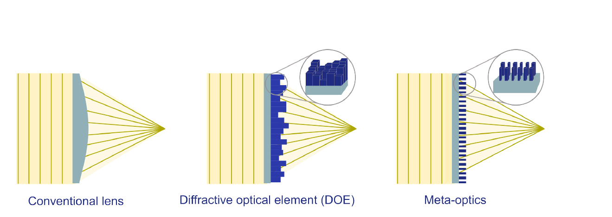
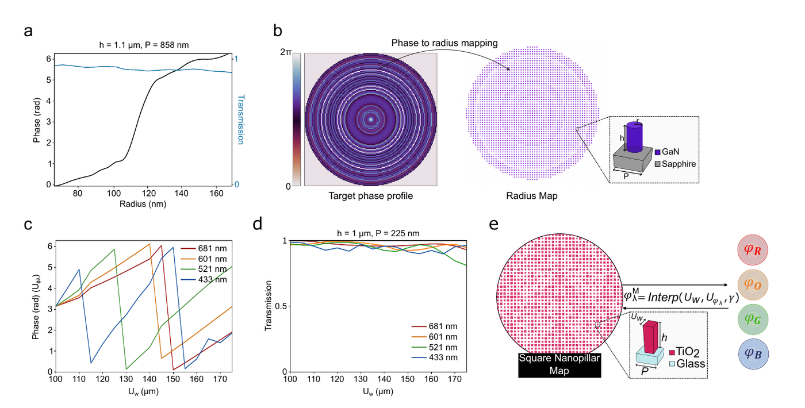

# Flat optics: DOEs and meta-optics

A learned phase profile \(\phi^M(x,y)\) is just an array of numbers. To use it in a microscope it must become a physical, thin, transparent element. The thesis uses two kinds of **flat optics**.

<figure markdown="span">
  { loading=lazy }
  <figcaption>Three ways to shape a wavefront: a curved refractive lens, a diffractive optical element (DOE) with a surface-relief height map, and a metasurface made of sub-wavelength nanostructures. Thesis Fig. 2.2.</figcaption>
</figure>

## Diffractive optical element (DOE)

A DOE delays light by changing the **thickness** of a transparent material. A local height \(h\) gives the phase

\[
\phi_{\mathrm{DOE}}(x,y;\lambda) = \frac{2\pi}{\lambda}\,\big[n_{\mathrm{DOE}}(\lambda) - n_{\mathrm{env}}(\lambda)\big]\,h(x,y).
\]

Phase is only defined modulo \(2\pi\), so the profile is **wrapped** and the maximum height is one wavelength of optical path. To convert a learned phase at the design wavelength \(\lambda_0\) into a height map, invert the relation point by point:

\[
h(x,y) = \frac{\lambda_0\,\phi(x,y;\lambda_0)}{2\pi\,[n_{\mathrm{DOE}}(\lambda_0) - n_{\mathrm{env}}(\lambda_0)]}.
\]

**Strengths:** simple and cheap to fabricate at large feature sizes. **Limits:** a minimum lateral feature size, a finite number of height levels (quantisation), and strong dispersion (the same height gives a different phase at another λ).

## Metasurface (meta-optic)

A metasurface is a dense array of **dielectric nanopillars**, each smaller than the wavelength. Each pillar acts like a short waveguide. Its lateral size sets the effective refractive index of the unit cell, and therefore the **phase delay** and **transmission** of the light passing through it.

Design uses a **unit-cell library**:

1. Fix the pillar height \(h\) and period \(P\).
2. Simulate a periodic array of identical pillars for a range of widths or radii, using FDTD or RCWA, at each wavelength of interest.
3. Store phase \(U_{\phi,\lambda}\) and transmission against geometry \(U_w\). Keep only geometries that cover \(0\)–\(2\pi\) with high transmission.
4. Place at each position of the element the pillar whose phase matches the target.

<figure markdown="span">
  { loading=lazy }
  <figcaption>(a) Phase and transmission of circular GaN pillars (h = 1.1 µm, P = 858 nm) against radius, used in Publication I. (b) Target phase → radius map. (c, d) Phase and transmission of square TiO₂ pillars (h = 1 µm, P = 225 nm) at the four emission wavelengths, used in Publication II. (e) One shared width map gives a different phase at each wavelength. Thesis Fig. 3.3, © 2023/2026 the authors, CC BY 4.0.</figcaption>
</figure>

!!! warning "Local periodic approximation"
    The library is computed for *periodic* arrays of *identical* pillars. Using it for a pillar surrounded by different neighbours ignores near-field coupling. The approximation is best when the geometry varies slowly across the element. The forward model also treats the amplitude inside the pupil as uniform: the transmission curves are used to pick a high-transmission geometry range, not as a spatially varying amplitude.

**Strengths:** very fine spatial control (one pillar per sub-micron cell), a rich design space, and, most importantly for Publication II, a **wavelength-dependent response that can itself be designed**. **Limits:** small features, high aspect ratios, and sensitivity to fabrication errors.

## Which one to use?

The deciding factor in this work is the **sampling pitch** \(\Delta s\) that the target depth range demands (see [Sampling criteria](../edof/sampling.md)):

| Situation | Choice in the thesis |
|---|---|
| Coarse pitch (tens to hundreds of µm): low NA, modest DoF | **DOE** height map is enough |
| Pitch around 1 µm or below: high NA and/or large DoF | **GaN metasurface** (Publication I; for ±1.5 mm the pitch 0.858 µm equals the unit-cell period) |
| Several wavelengths through one element | **TiO₂ metasurface** with a *wavelength-aware* library inside the optimisation (Publication II) |

!!! success "What this means for the method"
    The optical element is not a free phase map. It is constrained by what a DOE or a nanopillar library can physically produce. Publication II goes further and makes the **nanopillar widths themselves** the trainable variables. See [Optical element](../edof/optical-element.md).
