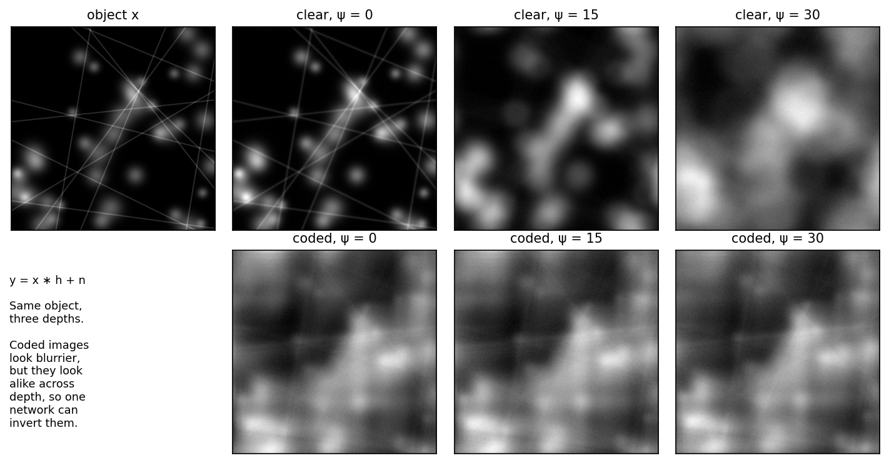
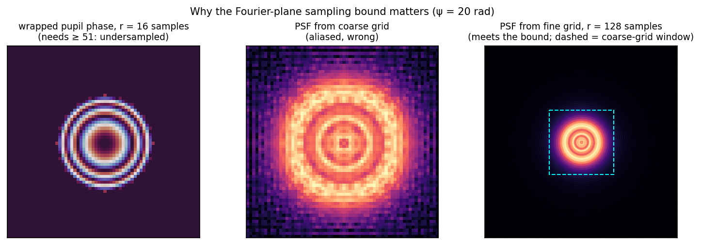

# Try it: toy simulation

Two small scripts in the `examples/` folder of this site's repository recreate the core physics with nothing but NumPy and Matplotlib. They run on a laptop in seconds and need no GPU and no data download.

```bash
pip install numpy matplotlib
python examples/toy_forward_model.py      # writes figures to docs/assets/figures/generated/
python examples/design_calculator.py      # prints ψ_max and Δs for the Publication I configurations
```

!!! info "Scope"
    These scripts are **teaching tools**. They use normalised units, a square grid and circular FFT convolution. They are *not* the differentiable, calibrated model used in the publications, which is available from the authors on request (see [Reproduce](../edof/reproduce.md)).

## 1. The whole forward model in five functions

```python
def pupil_grid(n, fill=0.5):            # normalised coords, pupil edge at rho = 1
    r_samples = fill * n / 2
    c = (np.arange(n) - n / 2) / r_samples
    u, v = np.meshgrid(c, c)
    rho2 = u**2 + v**2
    return u, v, rho2, (rho2 <= 1.0).astype(float)

def defocus_phase(rho2, psi):   return psi * rho2              # ψ ρ²
def cubic_phase(u, v, alpha):   return alpha * (u**3 + v**3)   # Dowski–Cathey

def psf_from_pupil(A, phase):                                   # h = |F{A e^{iφ}}|²
    E = np.fft.fftshift(np.fft.fft2(np.fft.ifftshift(A * np.exp(1j * phase))))
    h = np.abs(E) ** 2
    return h / h.sum()

def mtf_from_psf(h):                                            # |F{h}| / |F{h}|(0)
    m = np.abs(np.fft.fftshift(np.fft.fft2(np.fft.ifftshift(h))))
    return m / m.max()
```

Every learned design in the thesis follows this recipe: build the pupil phase, take a Fourier transform, square it, convolve. The publications add realistic optics (relay magnification, the real NA and wavelengths), a physical parameterisation of \(\phi^M\), and automatic differentiation.

## 2. What the camera sees

<figure markdown="span">
  { loading=lazy }
  <figcaption>Top: a clear pupil gives a sharp image at focus that quickly becomes useless with defocus. Bottom: a coded (cubic) pupil gives an image that is always blurred, but blurred <em>the same way</em> at every depth. That is what makes a single decoder possible.</figcaption>
</figure>

## 3. Why sampling matters

A large defocus coefficient means the pupil phase wraps through \(2\pi\) many times. If the simulation grid is too coarse, the phase **aliases** and the computed PSF is simply wrong. An optimiser would then learn to exploit a numerical artefact.

<figure markdown="span">
  { loading=lazy }
  <figcaption>ψ = 20 rad. Left: with 16 samples across the pupil radius the wrapped phase is undersampled (the bound asks for ≥ 51). Middle: the resulting PSF is aliased. Right: a grid meeting the bound gives the correct ring pattern.</figcaption>
</figure>

The bound used in the thesis is derived on the [Sampling criteria](../edof/sampling.md) page. `design_calculator.py` applies it and reproduces Table 1 of Publication I:

```text
objective    NA_eff       DoF |  psi_max  (paper) |    Δs µm  (paper)
RMS4X-PF      0.041   ±100 µm |     0.96     0.97 |  752.896      740
RMS4X-PF      0.041     ±1 mm |     9.82     9.88 |   73.780       73
RMS20X-PF     0.159   ±100 µm |    14.60    14.69 |   38.483       38
Mitutoyo50X   0.134   ±100 µm |    10.52    10.48 |   20.009       20
Mitutoyo50X   0.134     ±1 mm |   136.75   136.24 |    1.539     1.54
Mitutoyo50X   0.134   ±1.5 mm |   246.15   245.54 |    0.855    0.858
```

## Exercises

1. Increase `alpha` in `fig_psf_vs_defocus`. When do the coded PSFs stop changing with ψ? What happens to the MTF level?
2. Replace the cubic mask with a random phase. Is the MTF still depth-invariant? This is roughly what an optimiser starts from.
3. The MANTIS objective is a 60× lens designed for a 180 mm tube lens, so f₁ = 3 mm. Run `design_calculator.py --f1 3 --na 1.1 --dz 0.025 --wl 433` to compute ψ_max for the 50 µm design. Compare with 221.32 on the [Sampling](../edof/sampling.md) page.
