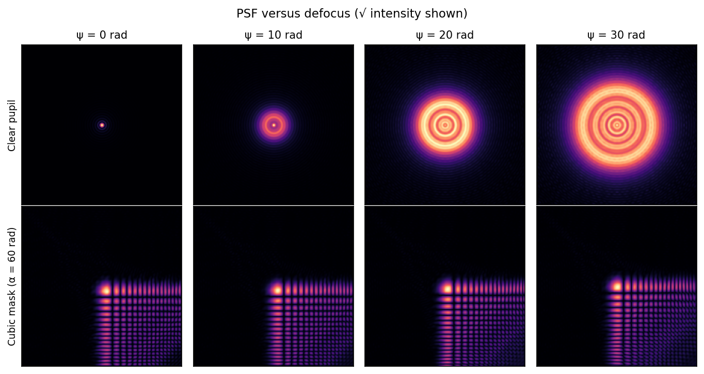
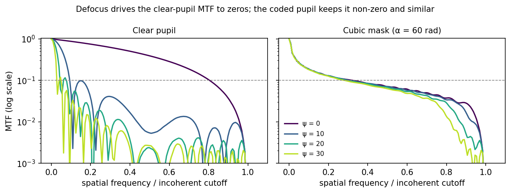

# Wavefront coding

**Wavefront coding** puts a phase mask in the pupil so that the PSF depends less on an aberration (here, defocus), then recovers the final image computationally. The optics alone no longer form a sharp image. They form an **encoded** image that stays decodable across the whole depth range.

## What a good encoder must do

With a pupil mask \(\phi^M\), the PSF at depth \(z\) is

\[
h_z = \Big\lvert \mathcal{F}\big\{ A\, e^{\,i(\psi_z\rho^2 + \phi^M)} \big\} \Big\rvert^2 .
\]

For a single decoder to work at every depth, we need:

1. **Similar PSFs across depth**, because the decoder does not know the depth of each object.
2. **No MTF zeros** in the band we want to recover, so the information is still present.
3. **High enough MTF**, so that decoding does not amplify noise too much.

These goals compete. A PSF that is completely invariant to depth usually has a very low MTF.

## The classical example: the cubic phase mask

Dowski and Cathey (1995) proposed \( \phi^M = \alpha\,(u^3+v^3) \), with normalised pupil coordinates \(u, v \in [-1,1]\). Complete the cube along one axis to see why it works:

\[
\alpha u^3 + \psi u^2 \;=\; \alpha\Big(u + \tfrac{\psi}{3\alpha}\Big)^3 \;-\; \tfrac{\psi^2}{3\alpha}\,u \;-\; \tfrac{\psi^3}{27\alpha^2}.
\]

With a strong cubic term (\(\alpha \gg \psi\)), defocus mostly **shifts** the cubic pattern slightly, adds a **linear phase** (a lateral image shift) and adds a constant. The PSF keeps its shape, so the MTF barely changes with depth.

<figure markdown="span">
  { loading=lazy }
  <figcaption>Toy simulation. Top: the clear-pupil PSF spreads into rings as defocus grows. Bottom: with a cubic mask the PSF is large but nearly unchanged with depth. Generated by <code>examples/toy_forward_model.py</code>.</figcaption>
</figure>

<figure markdown="span">
  { loading=lazy }
  <figcaption>The same comparison in frequency. The clear-pupil MTF falls quickly and hits zeros. The cubic-mask MTF is lower at focus but stays non-zero and nearly identical across depth.</figcaption>
</figure>

## Why a fixed analytical mask is not enough

The cubic mask has one parameter and was designed for *moderate* defocus. The thesis targets \( \psi_{\max} \) in the hundreds of radians. In that regime, Publication I shows that a cubic mask with a tuned α plus a U-Net fails. The sensor image is so blurred that the network cannot recover it: PSNR drops to about 22 dB at ±1.5 mm, compared with about 28 dB for the learned design. See [Simulation results](../edof/simulation-results.md).

## From hand-designed masks to end-to-end co-design

Instead of choosing \(\phi^M\) by hand, we make it a **trainable parameter** in a differentiable image-formation model, placed directly before a trainable reconstruction network \(f_\theta\):

\[
\min_{\phi,\theta}\; \frac{1}{N}\sum_{n} \mathcal{L}\Big( f_\theta\big(\mathcal{H}_\phi(x_n; z_n, \lambda_n)\big),\; x_n \Big).
\]

Two consequences:

- **No PSF-similarity loss is needed.** One network must reconstruct images from *all* sampled depths, so the optics are pushed to produce PSFs that one network can invert. Depth invariance emerges from the image loss.
- The optics are optimised for **what the decoder can use**, not for a hand-picked PSF property.

!!! success "What this means for the method"
    We need (i) a model of \(\mathcal{H}_\phi\) that is accurate and differentiable ([Forward model](../edof/forward-model.md)), (ii) a numerical grid fine enough for the huge defocus phases ([Sampling](../edof/sampling.md)), and (iii) a physical device that can produce the learned phase ([Flat optics](flat-optics.md)).
