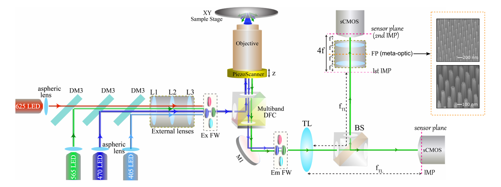
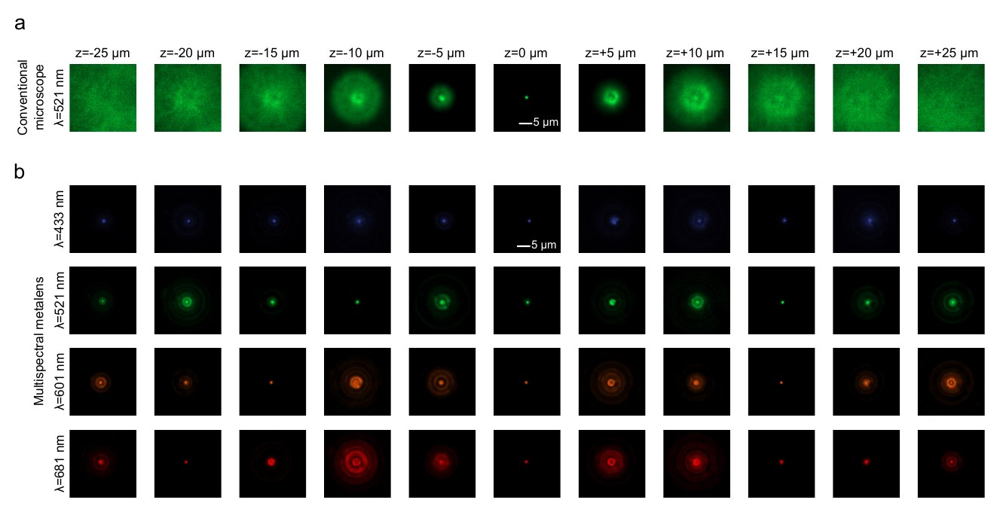
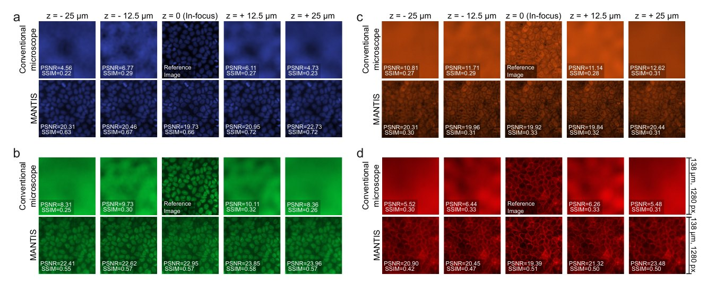
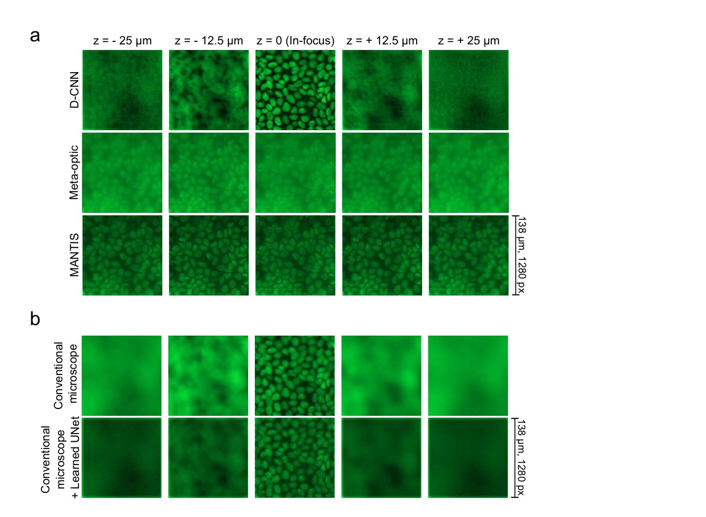
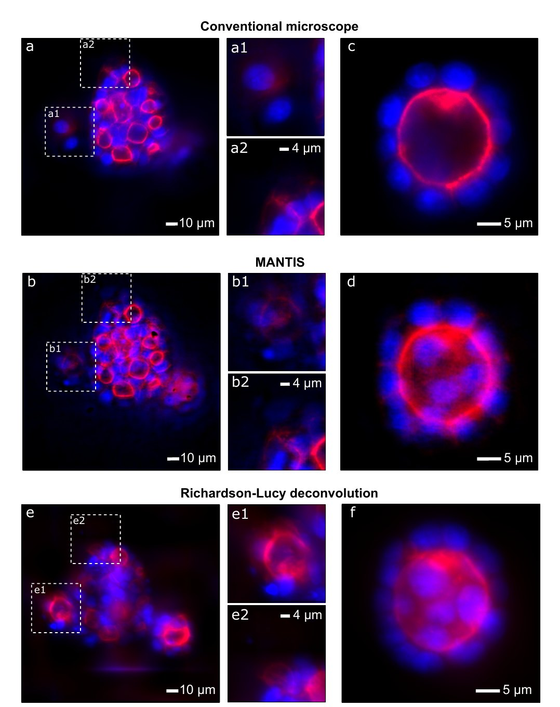
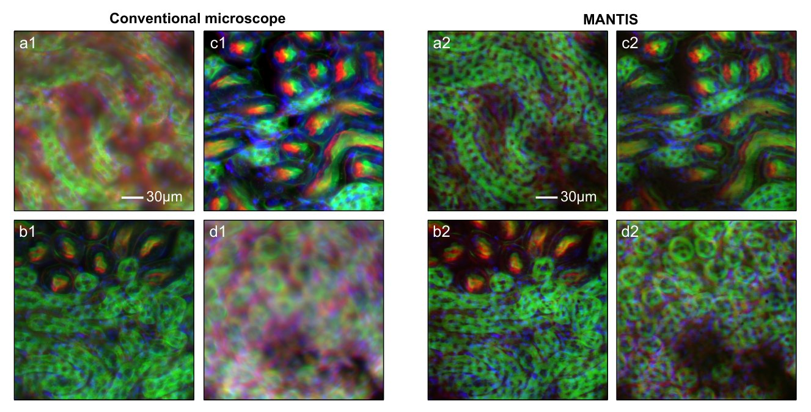

# 7. Experimental validation (MANTIS)

The 50 µm multispectral design was fabricated and mounted at the relayed Fourier plane of a modified wide-field epi-fluorescence microscope. The microscope has a 60×/1.1 NA water-immersion objective, a piezo stage, and sequential acquisition at the four emission bands.

## Setup: a built-in baseline

A beam splitter divides the imaging path into **two arms**. One arm is a conventional wide-field microscope. The other arm carries the 4f relay with the meta-optic. Every field of view is therefore recorded **simultaneously** by both systems, giving a frame-matched baseline. Only the meta-optic images go through the trained network. Wide-field images are shown as acquired.

<figure markdown="span">
  { loading=lazy }
  <figcaption>Dual-arm experimental microscope. The meta-optic sits at the Fourier plane of the 4f relay. Insets: SEM of the fabricated TiO₂ pillars. Thesis Fig. 3.9 (© 2026 the authors, CC BY 4.0).</figcaption>
</figure>

## PSF measurements

1 µm fluorescent beads (TetraSpeck) were embedded in an 11 kPa polyacrylamide hydrogel, excited by LED at each band, and scanned over 50 µm in 500 nm steps.

<figure markdown="span">
  { loading=lazy }
  <figcaption>Measured PSFs from −25 to +25 µm. (a) Conventional microscope at 521 nm: the PSF spreads quickly away from focus. (b) Multispectral meta-optic at all four wavelengths: compact across the whole range and similar between colours. Identical intensity scaling. Publication II, Fig. 3 (© 2026 the authors, CC BY 4.0).</figcaption>
</figure>

Lateral FWHM from 2D Gaussian fits (mean ± std over depth):

| λ (nm) | 433 | 521 | 601 | 681 |
|---|---|---|---|---|
| FWHM (µm) | 1.42 ± 0.38 | 1.73 ± 0.70 | 1.91 ± 0.95 | 1.94 ± 1.08 |
| Max deviation from best focus (µm) | 1.46 | 2.60 | 2.99 | 3.90 |

The spread across the four wavelengths at a given depth averages **0.57 µm** (max 1.68 µm). The measured PSFs agree with the simulated ones, which confirms that the fabricated geometry produces the designed wavelength-dependent phase.

!!! note "How to read the FWHM"
    The FWHM describes the **raw optical** PSF before reconstruction, not the final resolution after deblurring. The 1 µm bead is also larger than the ≈ 0.3 µm diffraction limit at NA 1.1, which broadens every measurement, including the reference, by the same amount.

## Cell monolayers (MDCK, 4 channels)

DAPI (433 nm), Alexa Fluor 488 lamin A/C (521 nm), Alexa Fluor 568 vimentin (601 nm) and Atto 643 phalloidin (681 nm). The sample was imaged at 5 planes across the 50 µm range. PSNR/SSIM use the **in-focus wide-field image** as reference.

<figure markdown="span">
  { loading=lazy }
  <figcaption>Wide-field (top rows) vs MANTIS (bottom rows) at z = −25 … +25 µm in (a) 433, (b) 521, (c) 601, (d) 681 nm. Wide-field loses cell morphology quickly off focus. MANTIS keeps it across the range. Publication II, Fig. 4 (© 2026 the authors, CC BY 4.0).</figcaption>
</figure>

### Ablation: are both halves needed?

At 521 nm the full system was compared with (i) the meta-optic without the network, (ii) the network on wide-field data without the meta-optic, and (iii) a network trained end-to-end on a purely wide-field model. Without the meta-optic, the network **cannot** undo high-NA defocus. Without the network, the coded images are only slightly sharper. Only the combination recovers the structure.

<figure markdown="span">
  { width="620" loading=lazy }
  <figcaption>Ablation at 521 nm. (a) Network only, meta-optic only, and full MANTIS. (b) Wide-field microscope with a learned U-Net. Thesis Fig. 3.13 (© 2026 the authors, CC BY 4.0).</figcaption>
</figure>

## Thick samples: 3D MDCK II spheroids (≈ 50 µm)

Spheroids with hollow lumens, labelled for F-actin (ATTO 643, magenta) and nuclei (DAPI, blue). Both images are **single exposures with no scanning**. As a further reference, wide-field z-stacks were deconvolved with Richardson–Lucy using measured PSFs and shown as maximum-intensity projections.

<figure markdown="span">
  { width="560" loading=lazy }
  <figcaption>Wide-field (a, c), MANTIS (b, d) and Richardson–Lucy deconvolution of a z-stack (e, f). MANTIS resolves individual nuclei and cell boundaries across the spheroid from one shot. Thesis Fig. 3.14 (© 2026 the authors, CC BY 4.0).</figcaption>
</figure>

## Generalisation: unseen tissue (16 µm mouse kidney section)

FluoCells Prepared Slide #3 (F24630): DAPI, WGA–Alexa Fluor 488 and phalloidin–Alexa Fluor 568. This tissue type was **not in training**. Images were taken at offsets of −7, −3.5, +3.5 and +7 µm from the section mid-plane, in different fields of view.

<figure markdown="span">
  { loading=lazy }
  <figcaption>Co-registered wide-field (a1–d1) and MANTIS (a2–d2) images. RGB = AF568, AF488, DAPI. Scale bar 30 µm. Publication II, Fig. 6 (© 2026 the authors, CC BY 4.0).</figcaption>
</figure>

!!! warning "EDoF is not optical sectioning"
    MANTIS produces an image in which structures from the whole depth range are in focus. It does **not** separate depths or refocus to a chosen plane. Varying \(z\) in these experiments tests robustness to axial displacement. Recovering the depth itself is the subject of the [FLFM work](../flfm/index.md).

## Single-wavelength reference

The 601 nm-only meta-optic gave well-formed PSFs at every wavelength, but its reconstructions varied strongly between channels: channel-averaged PSNR ranged from about 11 to 18 dB, with the best result at 681 nm rather than 601 nm. The multispectral design's uniform behaviour shows the value of **training for all bands together**.

## Sample preparation (summary)

Full protocols, reagents and catalogue numbers are in Publication II, Methods 4.4.

- **MDCK II monolayers:** cultured 5 days on #1.5H coverslips, fixed (4 % PFA), permeabilised (0.5 % Triton X-100), blocked (3 % BSA), immunolabelled, mounted in ProLong Diamond.
- **MDCK II spheroids:** 8000 cells per 40 µl Matrigel droplet, 7 days culture, fixed (4 % PFA + 0.01 % glutaraldehyde), phalloidin + DAPI.
- **Kidney:** commercial FluoCells slide, imaged as supplied.
- **PSF beads:** 1 µm TetraSpeck beads in 11 kPa polyacrylamide gels (≈ 200 µm thick).
