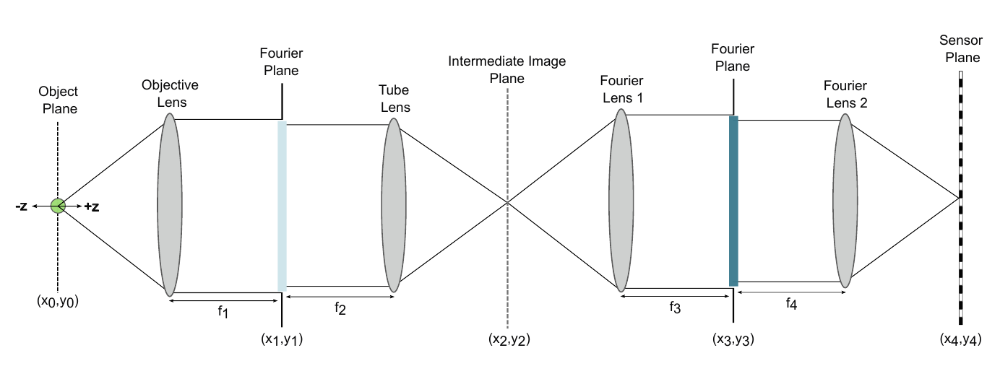

# 1. Forward model

The forward model \(\mathcal{H}_\phi\) turns a sharp ground-truth image, a depth \(z\) and a wavelength \(\lambda\) into a simulated camera image. It is used **only during training**. Afterwards the real microscope with the fabricated element takes its place.

## Optical layout

The system is an infinity-corrected fluorescence microscope followed by a **relay 4f system**:

- **Objective (f₁) + tube lens (f₂):** first imaging stage, forms an intermediate image. Their shared Fourier plane (the objective pupil, coordinates \((x_1,y_1)\)) is inside the objective and not accessible.
- **Relay lenses (f₃, f₄):** re-image the intermediate image onto the sensor \((x_4,y_4)\) and create an **accessible Fourier plane** \((x_3,y_3)\) conjugate to the pupil. The **optical coding element (OCE)** sits there.

<figure markdown="span">
  { loading=lazy }
  <figcaption>Optical layout of the EDoF microscope. Thesis Fig. 3.2 (© 2026 the authors, CC BY 4.0).</figcaption>
</figure>

### MANTIS system parameters

| Quantity | Value |
|---|---|
| Objective | 60×, NA 1.1, water immersion; f₁ = 3 mm (180 mm tube lens) |
| Objective pupil diameter \(D = 2\,\mathrm{NA}\,f_1\) | 6.6 mm |
| Relay lenses f₃ = f₄ | 75 mm, so the pupil is demagnified 180/75 = 2.4× |
| Meta-optic diameter \(2 r_{\mathrm{OCE}}\) | 2.75 mm |
| Emission channels | 433, 521, 601, 681 nm |
| Camera pixel | 6.5 µm (≈ 108 nm in the object; a 512 px patch covers 55.3 µm) |
| Meta-optic unit cell | TiO₂ square pillars, height 1 µm, period 225 nm, widths 100–175 nm |

## Step by step

**(1) Defocus at the objective pupil.** A point at axial offset \(z\) gives a quadratic phase over the pupil of radius \(r\):

\[
\phi_{\mathrm{defocus}}(x_1,y_1;z,\lambda) = \psi_z(\lambda)\,\frac{x_1^2+y_1^2}{r^2},
\qquad
\psi_z(\lambda) = \frac{\pi}{\lambda}\Big(\frac{1}{z}-\frac{1}{z_0}\Big)r^2,
\qquad r = \mathrm{NA}\,f_1 .
\]

**(2) Field at the intermediate image.**

\[
E_1(x_2,y_2;z,\lambda) = \mathcal{F}\big\{A(x_1,y_1)\,e^{\,i\phi_{\mathrm{defocus}}(x_1,y_1;z,\lambda)}\big\}.
\]

**(3) Coding element at the relayed Fourier plane.** The first relay lens Fourier-transforms \(E_1\). The element multiplies it by its complex transmission

\[
M(x_3,y_3;\lambda) = A_{\mathrm{OCE}}(x_3,y_3)\,e^{\,i\phi_{\mathrm{OCE}}(x_3,y_3;\lambda)},
\]

and the second relay lens transforms the result onto the sensor.

**(4) Incoherent PSF.**

\[
\mathrm{PSF}(x_4,y_4;z,\lambda) = \Big\lvert \mathcal{F}^{-1}\big\{ M(x_3,y_3;\lambda)\;\mathcal{F}\{E_1\} \big\} \Big\rvert^2 .
\]

It depends on the NA, the depth, the wavelength and the coding element.

**(5) Sensor image.** Fluorescent emitters are mutually incoherent and the PSF is assumed laterally shift-invariant, so

\[
y(x_4,y_4;z,\lambda) = x_s(x_4,y_4;\lambda) * \mathrm{PSF}(x_4,y_4;z,\lambda) + n(x_4,y_4),
\]

where \(x_s\) is the object mapped to sensor coordinates by the total magnification, and \(n\) is noise. Training uses zero-mean Gaussian noise \(n\sim\mathcal{N}(0,\sigma^2)\). Other noise models, such as Poisson, can be substituted.

For a genuinely volumetric sample discretised into \(N_z\) planes, contributions add:

\[
y(x_4,y_4;\lambda) = \sum_{k=1}^{N_z} x_s(x_4,y_4;z_k,\lambda) * \mathrm{PSF}(x_4,y_4;z_k,\lambda) + n .
\]

!!! note "Training uses planar objects at random depths"
    During training, one sharp 2D patch is placed at one of \(K\) depths at a time. The ground truth does not depend on depth. This isolates the effect of the depth-dependent PSF and teaches the network one inverse mapping for the whole range.

## In pseudo-code

```python
def forward(gt, z, wl, optic_params):
    phi_oce = optic_phase(optic_params, wl)           # DOE, GaN or TiO2 model (page 3)
    pupil   = A * exp(1j * psi(z, wl) * rho2)          # defocus at objective pupil
    E1      = fft2(pupil)                              # intermediate image field
    E3      = fft2(E1) * A_oce * exp(1j * phi_oce)     # relayed Fourier plane, coded
    psf     = abs(ifft2(E3))**2;  psf /= psf.sum()
    sensor  = conv2d(pad(gt), psf)[crop] + sigma * randn()
    return sensor
```

The real implementation is written in PyTorch so that every step is differentiable (see [End-to-end training](training.md#gradient-flow)).

!!! success "Next"
    The phases involved are huge (hundreds of radians at the pupil edge). How fine must the grid for \((x_3,y_3)\) be? See [Sampling criteria](sampling.md).
