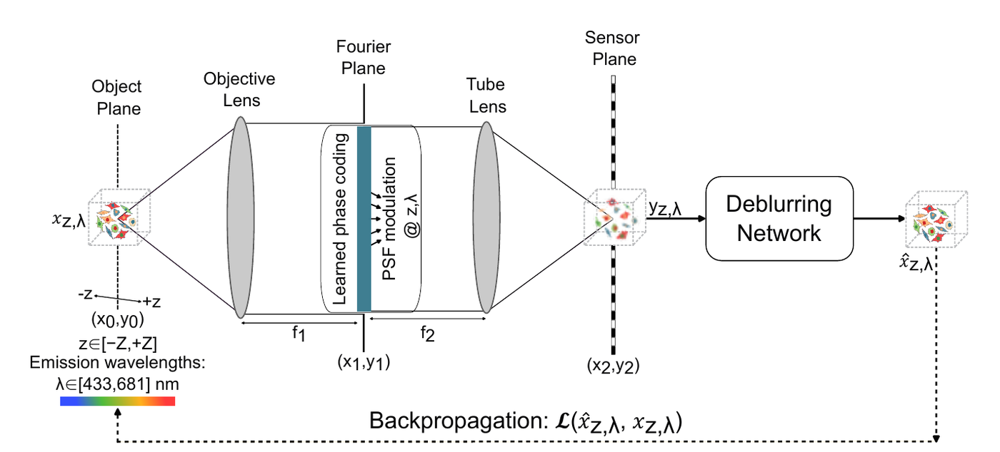

# Extended depth of field (EDoF) microscopy

**Goal:** from **one** camera exposure, recover a sharp fluorescence image of everything within a prescribed depth range, at high NA and in several colour channels, with no axial scanning.

**Approach:** place a learned flat optical element in the Fourier plane of the microscope. Train it **jointly** with a deblurring neural network through a differentiable wave-optics model.

<figure markdown="span">
  { loading=lazy }
  <figcaption>End-to-end EDoF framework. A Fourier-plane phase element encodes depth and wavelength information, and a deblurring network reconstructs a sharp image. Both are updated by back-propagating the reconstruction loss. Thesis Fig. 3.1.</figcaption>
</figure>

## The problem in one equation

\[
\min_{\phi,\theta}\;\frac{1}{N}\sum_{n=1}^{N}
\mathcal{L}\Big(\underbrace{f_\theta}_{\text{network}}\big(\underbrace{\mathcal{H}_\phi(x_n;\,z_n,\lambda_n)}_{\text{microscope + learned optic}}\big),\;x_n\Big)
\]

- \(\mathcal{H}_\phi\): the image formation of the microscope with the coding element \(\phi\). It depends on the object's depth \(z\) and wavelength \(\lambda\).
- \(f_\theta\): the reconstruction network. It does **not** receive \(z\) as input, because depth is unknown when imaging real samples.
- \(\mathcal{L}\): an image loss against the in-focus ground truth \(x_n\).

## Two publications, one framework

| | **Publication I** (Nanophotonics 2023) | **Publication II: MANTIS** (Light Sci. Appl. 2026) |
|---|---|---|
| Question | How should the optic be *sampled and realised* for a given NA and DoF? | Can one optic serve *four colours* at *NA 1.1*, in a real microscope? |
| Channels | 1 (550 nm design) | 4 (433, 521, 601, 681 nm) |
| Optic | Learned phase map → DOE height map or GaN metalens radius map | TiO₂ nanopillar **width map learned directly** through a wavelength-dependent library |
| Network | U-Net with residual output | U-Net with instance norm, spectral 1×1 mixing and Fourier channel attention |
| Loss | RMSE over depths | RMSE + SSIM + gradient + low-pass, over depths and wavelengths |
| Targets | ±100 µm, ±1 mm, ±1.5 mm (low/moderate NA) | 25, 50, 75 µm (NA 1.1) |
| Validation | Simulation, fabrication-error analysis | Simulation **and** fabricated device: beads, cell monolayers, 3D spheroids, kidney tissue |
| Code / data | On request | [GitHub](https://github.com/humeyracaglayan/MANTIS) · [Zenodo dataset](https://doi.org/10.5281/zenodo.18609221) |

## Headline results

27.98 dB

PSNR at ±1.5 mm (ψmax = 245.5), vs 21.9 dB (cubic) and 21.1 dB (DeepDOF). Pub. I

50 µm @ NA 1.1

experimental single-shot EDoF, 82× the native DoF. Pub. II

ψmax 110–333

rad of defocus at NA 1.1; earlier EDoF works report ≈ 25–82. Pub. II

4 channels

near-uniform quality across wavelength from one shared meta-optic

## Reading order

1. [Forward model](forward-model.md): how the sensor image is simulated.
2. [Sampling criteria](sampling.md): how fine the Fourier-plane grid must be, and why this sets the choice of DOE or meta-optic.
3. [Optical element](optical-element.md): DOE, GaN and TiO₂ parameterisations.
4. [Neural reconstruction](reconstruction.md): the two deblurring networks.
5. [End-to-end training](training.md): datasets, depth sampling, losses, gradient flow, initialisation.
6. [Simulation results](simulation-results.md)
7. [Experimental validation](experiments.md)
8. [Reproduce](reproduce.md)
9. [Limitations and notes](limitations.md)
