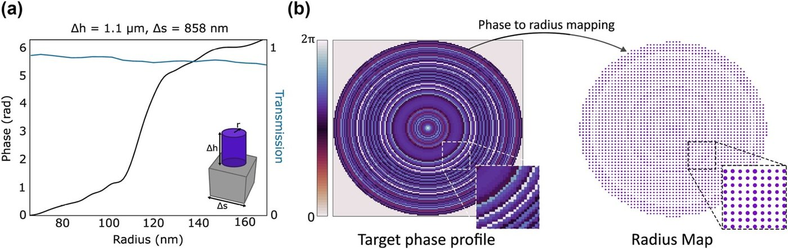
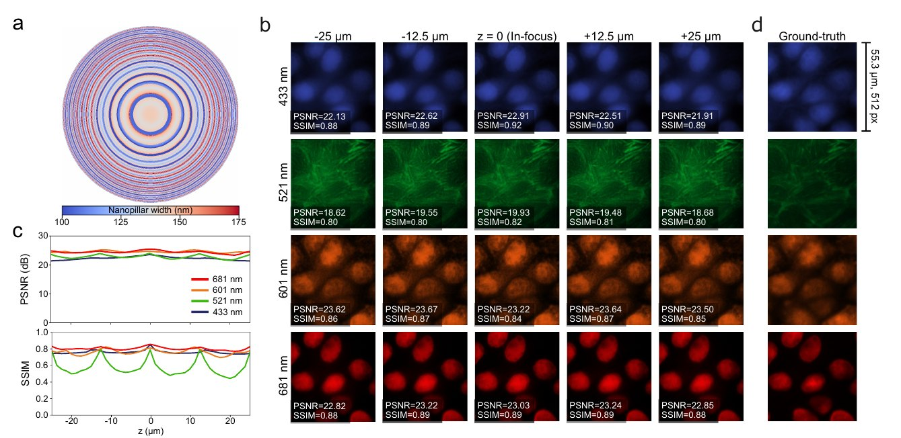
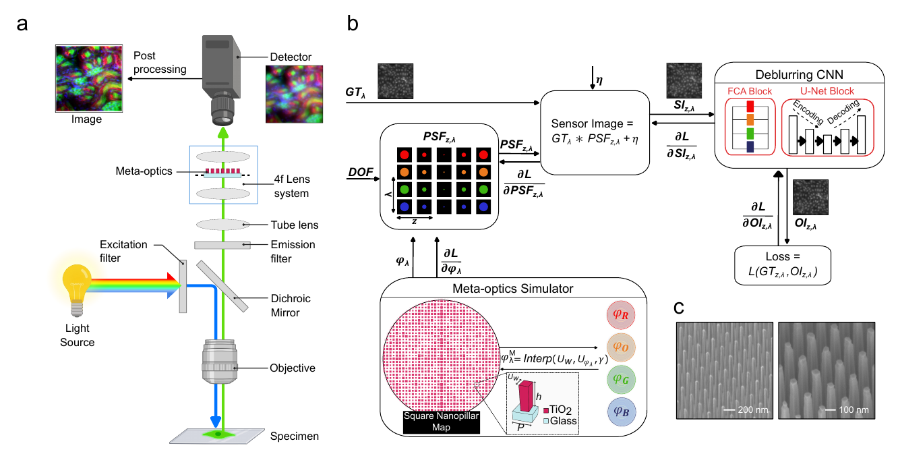

# 3. Optical element

The forward model needs \(\phi_{\mathrm{OCE}}(x_3,y_3;\lambda)\), the phase added by the coding element. The two publications parameterise it differently. In both, the amplitude is a binary circular pupil:

\[
A_{\mathrm{OCE}}(x_3,y_3) = \begin{cases} 1, & x_3^2+y_3^2 \le r_{\mathrm{OCE}}^2 \\ 0, & \text{otherwise}\end{cases},
\qquad r_{\mathrm{OCE}} = \lvert M_p\rvert\, f_1\,\mathrm{NA}.
\]

## Publication I: learn a phase, then build it

The trainable variable is the **phase map itself**, one value per \(\Delta s\) cell. After training, it is converted to hardware depending on the required pitch:

=== "DOE (coarse pitch)"

    Point-wise height conversion at the design wavelength \(\lambda_0 = 550\) nm, with refractive index \(n = 1.5\):

    \[
    \phi^M(x,y) = k\,(n-1)\,h(x,y)
    \;\;\Longrightarrow\;\;
    h(x,y) = \frac{\phi^M(x,y)}{k\,(n-1)},\qquad k = \frac{2\pi}{\lambda_0}.
    \]

    The DOE is assumed lossless (constant amplitude inside the pupil).

=== "GaN metalens (fine pitch)"

    Circular GaN nanopillars (n ≈ 2.42) on sapphire. Height and period are fixed (h = 1.1 µm, P = 858 nm) and the **radius** is varied. FDTD simulations give full \(0\)–\(2\pi\) coverage with transmission above 83 % at 550 nm. The learned phase at each cell is mapped to the radius whose simulated phase is closest.

    The smallest radius is set by fabrication. The largest diameter is 50 nm smaller than \(\Delta s\), so neighbouring pillars never touch.

<figure markdown="span">
  { loading=lazy }
  <figcaption>(a) FDTD phase and transmission of GaN nanopillars against radius. (b) The optimised phase is converted into a radius map. Publication I, Fig. 3 (© 2023 the authors, CC BY 4.0).</figcaption>
</figure>

## Publication II: learn the geometry directly, for four colours

With one element serving four wavelengths, a single "phase map" does not exist: the same pillar delays 433 nm and 681 nm light differently. The trainable variable is therefore the **physical geometry**, a map of square TiO₂ pillar widths \(w(x_3,y_3)\). Each wavelength's phase is read from its own unit-cell library by **differentiable interpolation**:

\[
\phi^{M}_{\lambda_j}(x_3,y_3) = \mathrm{Interp}\big(U_w,\;U_{\phi,\lambda_j};\;w(x_3,y_3)\big),\qquad j = 1,\dots,4 .
\]

\(U_w\) holds the simulated widths (100–175 nm) and \(U_{\phi,\lambda_j}\) the corresponding RCWA phases at \(\lambda_j\). Linear interpolation is differentiable, so the gradient of the loss with respect to each phase flows back to the shared width.

**Compact, rotationally symmetric parameterisation.** Instead of a free 2D map, the width is described by a radial vector \(\gamma\) (one value per ring of cells), which a fixed operator replicates around the azimuth:

\[
\gamma = \gamma_{\mathrm{init}} + \Delta\gamma,\qquad
\Gamma_{\mathrm{full}} = \mathrm{Rot}_K(\gamma).
\]

\(\gamma_{\mathrm{init}}\) comes from a frequency-domain pre-optimisation (see [training](training.md#initialisation-of-the-meta-optic)), and \(\Delta\gamma\) is learned. This reduces the number of optical parameters from about \(N^2\) to about \(N/2\), keeps the design rotationally symmetric (as defocus is), and makes the optimisation much better conditioned.

<figure markdown="span">
  { loading=lazy }
  <figcaption>(a) The learned multispectral meta-optic (50 µm target) as a nanopillar-width map: concentric rings from the rotational parameterisation. (b–d) Simulated reconstructions and metrics, discussed on the Simulation results page. Publication II, Fig. 2 (© 2026 the authors, CC BY 4.0).</figcaption>
</figure>

## Fabrication (Publication II)

The learned TiO₂ design was written by **electron-beam lithography and reactive-ion etching** into a high-index TiO₂ layer on fused silica. Full steps are in the thesis (Appendix A) and in Supplementary Section 8 of Publication II. The SEM images below show the fabricated pillars.

<figure markdown="span">
  { loading=lazy }
  <figcaption>(a) MANTIS: a wide-field fluorescence microscope with the meta-optic at the relayed Fourier plane. (b) Differentiable modelling pipeline. (c) SEM images of the fabricated TiO₂ meta-optic (scale bars 200 nm and 100 nm). Publication II, Fig. 1 (© 2026 the authors, CC BY 4.0).</figcaption>
</figure>

!!! info "Design space in one sentence"
    Publication I asks *what phase* is needed and then asks whether a DOE or a metasurface can make it. Publication II only ever searches over phases that the **fabricable TiO₂ library can produce at all four wavelengths at once**.
