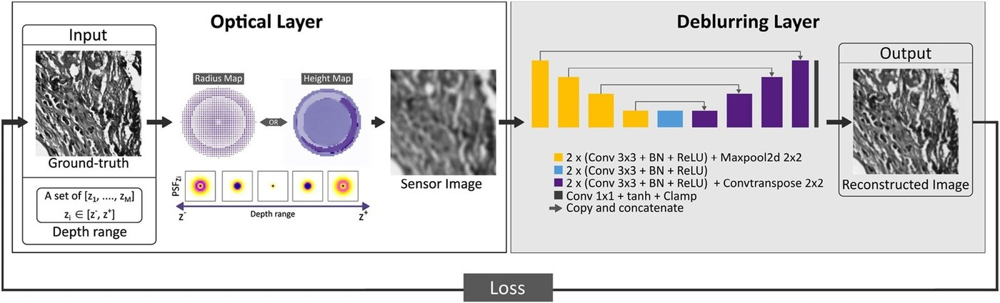

# 4. Neural reconstruction

The coded sensor image already contains the object's information, but in a blurred and scrambled form. A **deblurring convolutional neural network (D-CNN)** \(f_\theta\) decodes it:

\[
\hat{x} = f_\theta(y).
\]

!!! important "The network is not told the depth"
    The same network, with the same weights, processes images from every depth in the target range. During training, sensor images are generated with depth-dependent PSFs, so the network must learn **one inverse for the whole family of PSFs**. This matches real use, where the depth of each structure is unknown.

## Shared ideas

Both networks are **U-Nets** (Ronneberger et al., 2015). An encoder shrinks the image while widening the receptive field. A decoder restores resolution. Skip connections carry fine detail across. This suits deblurring, which needs both a large context (the blur is wide) and precise localisation (the detail is fine).

Both use **residual learning with a bounded output**:

\[
r_\theta(y) = \tanh\big(g_\theta(y)\big),\qquad
\hat{x} = \mathrm{clamp}\big(y + r_\theta(y),\,0,\,1\big).
\]

The coded image already carries the low-frequency content, so the network only has to learn the *correction*: it restores attenuated frequencies and removes the signature of the coded PSF. The \(\tanh\) keeps the correction bounded, and the clamp keeps intensities physical.

## Publication I: single channel

- Input and output: one grayscale channel, 256 × 256 training patches. Any size that is a multiple of 16 works at inference.
- Encoder: 2 × (3×3 conv + BN + ReLU), then 2×2 max-pool per level. Features grow from 32 to 512 channels, 23 convolution layers in total.
- Decoder: 2 × (3×3 conv + BN + ReLU), then 2×2 transposed convolution.
- Head: 1×1 conv → tanh → add input → clamp.

<figure markdown="span">
  { loading=lazy }
  <figcaption>Publication I: optical layer (radius map or height map, PSFs over the depth range) followed by the U-Net deblurring layer. Publication I, Fig. 2 (© 2023 the authors, CC BY 4.0).</figcaption>
</figure>

## Publication II: four channels jointly

Colour channels differ strongly in brightness and texture: different fluorophores, quantum efficiencies, filters and camera response. The multispectral network adds a small **spectral front-end** before a three-level U-Net:

| Block | What it does | Why |
|---|---|---|
| **InstanceNorm** per channel | Normalises each channel's intensity statistics | Stops the network from keying on absolute brightness differences between dyes |
| **1×1 conv, identity-initialised** | Learns linear mixtures of the 4 channels | Starts as "pass-through", then discovers useful cross-channel combinations |
| **Fourier-domain channel attention (FCA)** | Computes each channel's FFT magnitude, maps it through a small MLP to a gate, and re-weights the channels | Emphasises channels that carry more high-frequency content and damps blur- or noise-dominated ones |
| 3-level U-Net | Encoder 32 → 128 features (2×2 max-pool + 2 × [3×3 conv, norm, ReLU]); decoder with upsampling and skip connections | Spatial deblurring |
| 1×1 conv → 4 outputs, residual, bounded | One corrected output per wavelength | Channels share information without being forced to look alike |

Training uses 512 × 512 patches. Each ground-truth patch is convolved with its depth- and wavelength-specific PSF on a larger canvas and cropped back to 512 × 512, so convolution borders never enter the network.

!!! note "Speed"
    Inference on an NVIDIA Tesla V100 (32 GB): **7.53 ms** per 4-channel 512² patch (≈ 133 patches/s), and **46.97 ms** per 1280 × 1280 experimental image (≈ 21 frames/s).

## Why joint four-channel reconstruction?

Running four independent single-channel networks cannot use the structure *shared* between channels, such as a cell boundary visible in actin and implied by the nuclei layout. The 1×1 mixing and the FCA block let channels exchange information, while the last layer still produces a separate estimate per wavelength. The single-wavelength comparison in [Simulation results](simulation-results.md#single-wavelength-vs-multispectral-design) and [Experiments](experiments.md#single-wavelength-reference) shows what is gained.

!!! tip "Implementation in the public code"
    The released network is in [`unet.py`](https://github.com/humeyracaglayan/MANTIS/blob/main/unet.py). The class `FourierChannelAttention` implements the FCA block. Small implementation choices, such as GroupNorm inside the U-Net blocks and a sigmoid-bounded residual head, are documented on the [Reproduce](reproduce.md#what-the-released-code-does) page.
