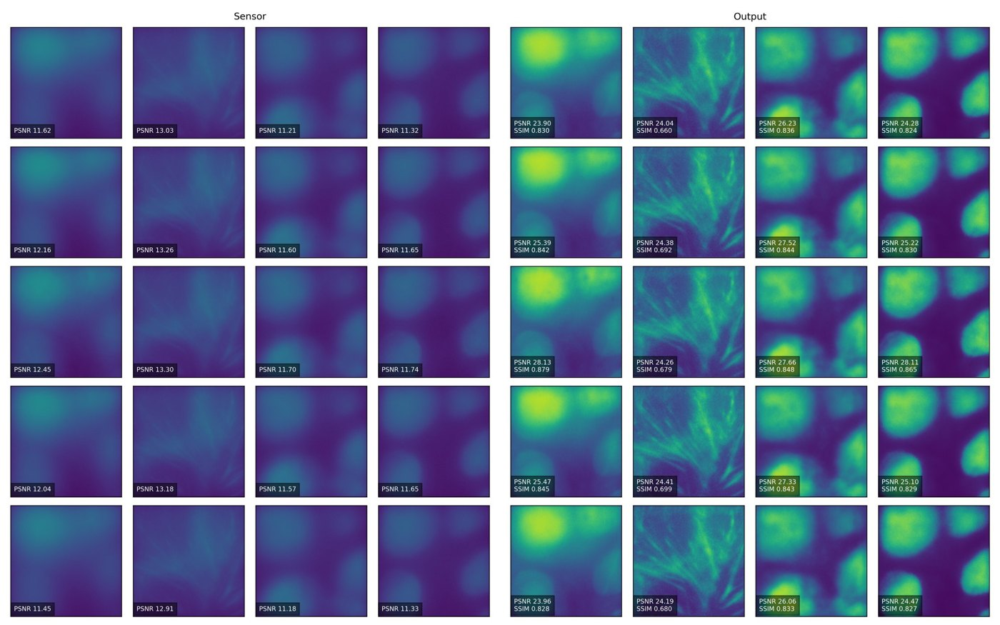

# 8. Reproduce

This page shows how to run the public MANTIS code: generate simulated sensor images with the trained optics, reconstruct them with the trained network, and retrain the network yourself.

## What is public

| Component | Where | Notes |
|---|---|---|
| Reconstruction network (training + inference code) | [github.com/humeyracaglayan/MANTIS](https://github.com/humeyracaglayan/MANTIS) | MIT licence |
| Pretrained network weights `deblurring_module.pt` (≈ 8 MB) | [Release v1.0.0](https://github.com/humeyracaglayan/MANTIS/releases/tag/v1.0.0) | TorchScript |
| Pretrained optical forward model `optic_module.pt` (≈ 730 MB) | [Release v1.0.0](https://github.com/humeyracaglayan/MANTIS/releases/tag/v1.0.0) | TorchScript **black box**: ground truth → simulated sensor image for the learned 50 µm meta-optic |
| MDCK four-channel dataset | [Zenodo, doi:10.5281/zenodo.18609221](https://doi.org/10.5281/zenodo.18609221) | Plus a few samples inside the repository |
| Differentiable optics code (for re-designing the meta-optic) | On request from the authors | Not public yet because of ongoing IP protection |
| Toy physics scripts | `examples/` in this site's repository | NumPy only, see [Toy simulation](../background/toy-simulation.md) |

!!! info "What you can and cannot reproduce with public material"
    ✅ Simulated sensor images of the published meta-optic, reconstruction, PSNR/SSIM, and **retraining the network** on the frozen optics.<br>
    ⛔ Re-optimising the **meta-optic itself** (true end-to-end training) needs the differentiable optics code, available on request.

## 1. Set up

```bash
git clone https://github.com/humeyracaglayan/MANTIS.git
cd MANTIS

python -m venv .venv && source .venv/bin/activate      # Windows: .venv\Scripts\activate
pip install torch torchvision                           # pick the CUDA build for your GPU at pytorch.org
pip install pytorch-lightning torchmetrics piq numpy matplotlib pillow
```

Tested software is not pinned in the repository. Any recent PyTorch 2.x with a matching PyTorch Lightning should work.

## 2. Download the pretrained models

```bash
curl -L -O https://github.com/humeyracaglayan/MANTIS/releases/download/v1.0.0/optic_module.pt
curl -L -O https://github.com/humeyracaglayan/MANTIS/releases/download/v1.0.0/deblurring_module.pt
```

Put both files in the repository root.

## 3. Run inference on the example image

```bash
python load_models_and_predict.py
```

The script:

1. loads `test_img.png`, a four-channel 512 × 512 MDCK patch stored as an RGBA PNG (one channel per emission band), normalised to [0, 1];
2. repeats it at **5 depths** across the 50 µm range;
3. runs the **optical black box** on CPU to get the coded sensor images;
4. adds Gaussian noise (σ = 0.01) and clips negatives;
5. reconstructs with the D-CNN (GPU if available);
6. writes `Groundtruth.png`, `Sensor.png`, `Output.png` and `metrics.csv` to `predict_outputs/`.

**What you should get.** Rows are the 5 depths, columns the 4 spectral channels in the PNG's channel order:

<figure markdown="span">
  { loading=lazy }
  <figcaption>Left: simulated coded sensor images (PSNR ≈ 11–13 dB against the ground truth). Right: reconstructions (PSNR ≈ 24–28 dB, SSIM ≈ 0.66–0.88). Reference output shipped in the repository (<code>predicted_outputs/</code>).</figcaption>
</figure>

| PNG channel | Sensor PSNR (dB) | Output PSNR (dB) | Output SSIM |
|---|---|---|---|
| 0 | 11.4–12.4 | 23.9–28.1 | 0.83–0.88 |
| 1 | 12.9–13.3 | 24.0–24.4 | 0.66–0.70 |
| 2 | 11.2–11.7 | 26.1–27.7 | 0.83–0.85 |
| 3 | 11.3–11.7 | 24.3–28.1 | 0.82–0.87 |

*Range over the 5 depths, from the repository's reference `metrics.csv`. The noise is random, so your numbers will differ slightly. The filament-rich channel (1) has the lowest SSIM, because fine, low-contrast texture is the hardest to restore.*

## 4. Retrain the reconstruction network

Download the dataset from Zenodo and arrange it as:

```text
multi-channel-edof_dataset/
├── train/        *.png   (4-channel, 512 × 512)
├── validation/   *.png
└── test/         *.png
```

Then:

```bash
python main.py --data_dir ./multi-channel-edof_dataset \
               --optic_blackbox_path optic_module.pt \
               --max_epochs 50 --accelerator gpu --devices 1
```

The optics stay **frozen**, and only the D-CNN is trained. Checkpoints are saved every 2 epochs to `checkpoints/`, and CSV logs go to `logs/train/`.

### Default settings (`main.py`, `lit.py`)

| Setting | Value |
|---|---|
| Depths per sample (`n_phi`) | 5 |
| Sensor noise σ | 0.01 (Gaussian, then ReLU) |
| Batch size | 1 |
| Optimiser | Adam, lr 1e-4, weight decay 1e-3 |
| Epochs | 50 |
| Loss | 0.65 · RMSE + 0.15 · (1 − SSIM) + 0.10 · gradient L1 + 0.10 · low-pass MSE |
| SSIM / low-pass | computed on 4 × 4 average-pooled images |
| Augmentation | random horizontal/vertical flips, brightness × U(0.8, 1.1), re-normalised to max 1 |

## What the released code does

For readers comparing the code with the paper, here are the concrete choices in `unet.py`:

- **Front end:** `InstanceNorm2d` (affine) → identity-initialised 1×1 conv (`spectral_mix`) → `FourierChannelAttention` (mean FFT magnitude per channel → MLP → gate \(1 + 0.3\,(a - \bar a)\)).
- **U-Net:** encoder 32 → 64 → 128 → 256 channels. Each block is 2 × (3×3 conv, GroupNorm(8), ReLU). The decoder uses transposed convolutions (`bilinear=False` in training) and skip connections.
- **Head:** 1×1 conv, residual \(x_{\mathrm{mixed}} + 0.5\,o\), then a learnable per-channel gain/bias and a **sigmoid**, which bounds the output to (0, 1) without a hard clamp.

## Troubleshooting

??? question "`ModuleNotFoundError: torchmetrics`"
    `lit.py` uses `torchmetrics` for SSIM during training: `pip install torchmetrics`.

??? question "Training on a machine without a GPU"
    `dataset.py` calls `torch.cuda.FloatTensor(1)` in `setup()`. Remove that line and pass `--accelerator cpu`. Expect training to be very slow. Inference (`load_models_and_predict.py`) already works on CPU.

??? question "Lots of printed `fvec` / `gate` lines"
    `FourierChannelAttention.forward` prints diagnostics on every call. Comment out the two `print` statements for clean logs.

??? question "Memory"
    The optical black box is about 730 MB and runs on CPU. Allow at least 8 GB of RAM for inference on 512 × 512 × 4 inputs at 5 depths.

## Publication I (single wavelength)

The Publication I code (single-wavelength DOE / GaN metalens designs) is not public. It uses the same framework as MANTIS. The key design numbers can be reproduced with `examples/design_calculator.py` ([Sampling](sampling.md)), and the framework is fully described on pages 1–5.

## Citing

If you use the code or data, please cite Publication II (and Publication I for the design methodology). BibTeX is on the [Publications](../resources/publications.md) page.
