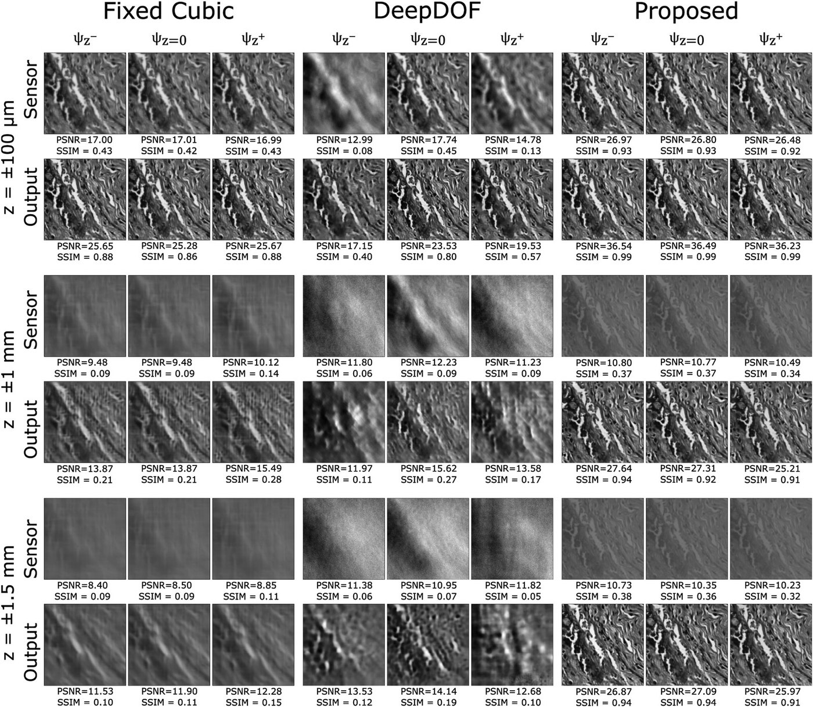
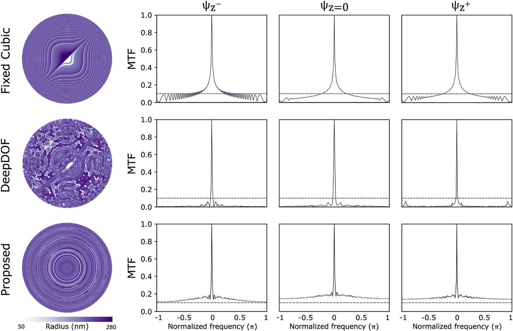
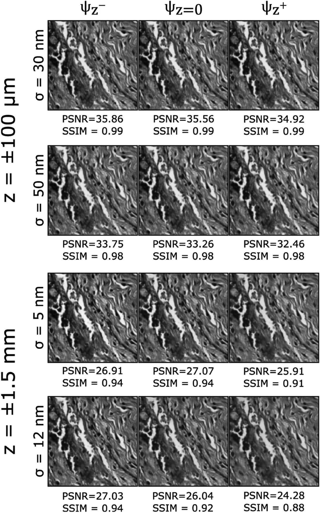
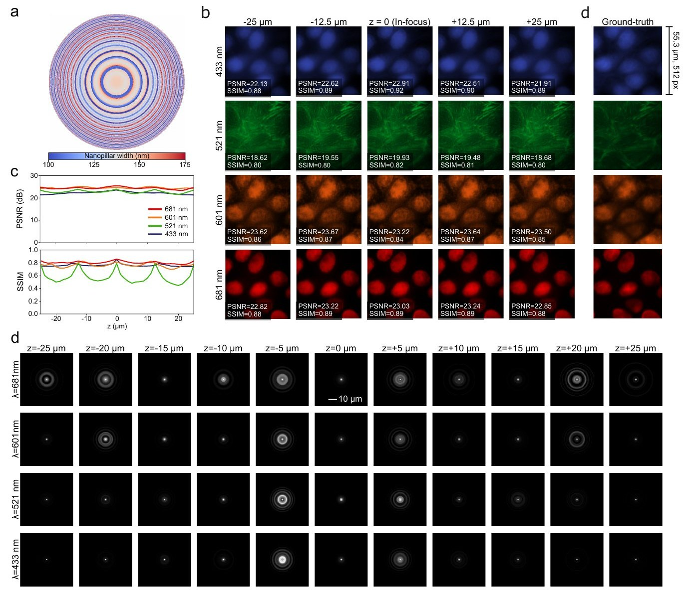

# 6. Simulation results

Image quality is measured by **PSNR** (peak signal-to-noise ratio, dB, higher is better) and **SSIM** (structural similarity, 0–1, higher is better). Both are averaged over the sampled depths and, for Publication II, over the four channels.

## Publication I: single wavelength, how far can DoF be pushed?

The design was tested across objectives and target ranges spanning \(\psi_{\max}\) from below 1 to about 246 rad. It was compared with two baselines simulated with **identical** system parameters:

- **Fixed cubic mask + U-Net**: the cubic strength α was tuned per range (6π, 200π, 360π) so that the MTF was as defocus-insensitive as possible.
- **DeepDOF** (Jin et al., PNAS 2020): end-to-end, with the optic in a **Zernike basis**. The number of Zernike terms (11, 1100, 2000) was chosen with the same sampling reasoning.

| Method | ±100 µm | ±1 mm | ±1.5 mm |
|---|---|---|---|
| Fixed cubic + U-Net | 34.99 dB / 0.92 | 23.60 dB / 0.62 | 21.86 dB / 0.58 |
| DeepDOF | 28.90 dB / 0.80 (28.85 / 0.81 with 55 Zernikes) | 20.67 dB / 0.55 | 21.14 dB / 0.58 |
| **Learned (this work)** | **38.19 dB / 0.98** | **29.28 dB / 0.89** | **27.98 dB / 0.89** |

*PSNR / SSIM, mean over 150 test images and all sampled depths. The ±100 µm case uses NAeff 0.041, within the native DoF of that aperture, so it serves as a low-difficulty reference. See [Limitations](limitations.md#effective-na-in-publication-i).*

<figure markdown="span">
  { loading=lazy }
  <figcaption>Sensor images and reconstructions for the cubic mask, DeepDOF and the learned design, at the near edge, centre and far edge of each depth range. Publication I, Fig. 4 (© 2023 the authors, CC BY 4.0).</figcaption>
</figure>

**Why the baselines fail at large DoF.** With the cubic mask, the sensor image becomes too blurred for the network to recover. With DeepDOF, a Zernike basis **under-samples the frequency content** of the phase needed at high \(\psi\). Adding more Zernike terms than the sampling analysis requires (starred entry) does not help, which supports the sampling-based sizing of the design space.

### MTF view

<figure markdown="span">
  { loading=lazy }
  <figcaption>Optimised element (left) and MTFs at the near edge, centre and far edge of the 3 mm range. The learned design keeps the MTF above the 0.1 threshold (dashed) across the band and almost identical across depth. Publication I, Fig. 5 (© 2023 the authors, CC BY 4.0).</figcaption>
</figure>

### Robustness to fabrication errors

Random Gaussian errors were added to the finished designs at test time: σr = 5 and 12 nm on metasurface radii, σh = 30 and 50 nm on DOE heights.

- ±100 µm (DOE): PSNR goes from about 35.9 / 35.6 / 34.9 dB (σh = 30 nm) to 33.8 / 33.3 / 32.5 dB (50 nm). SSIM stays at 0.98–0.99.
- ±1.5 mm (metalens): PSNR stays around 26–27 dB and SSIM around 0.88–0.94. Some degradation appears at 12 nm, mostly at the edges of the depth range.

Remedies: include fabrication tolerances during training, or fine-tune the network on the fabricated device.

<figure markdown="span">
  { width="480" loading=lazy }
  <figcaption>Reconstructions with increasing radius and height errors. Publication I, Fig. 6 (© 2023 the authors, CC BY 4.0).</figcaption>
</figure>

## Publication II: high NA, four colours

NA 1.1, λ ∈ {433, 521, 601, 681} nm, evaluated on 47 multispectral test images at **41 depth planes** (uniform in diopters) across each range:

| Target DoF | \(\psi_{\max}\) | \(\Delta s\) (µm) | PSNR (dB) | SSIM |
|---|---|---|---|---|
| 25 µm | 110.20 | 2.25 | 24.99 | 0.78 |
| 50 µm | 221.32 | 1.125 | 23.53 | 0.70 |
| 75 µm | 333.38 | 0.675 | 22.51 | 0.68 |

As expected, quality decreases gradually as the range, and with it the defocus, grows. For context, recent EDoF works report \(\psi_{\max} \approx 82\) (E2E-BPF), 24.6 (DeepDOF-SE) and 24.6 (Zhang et al.), mostly at one wavelength. MANTIS works at 1.3–4× the defocus of E2E-BPF and 4.5–13.5× that of DeepDOF-SE and Zhang et al., and does so in four channels.

<figure markdown="span">
  { loading=lazy }
  <figcaption>50 µm design. (a) Learned width map. (b) Reconstructions of a 4-channel patch at five depths, with (d) the depth-independent ground truth. (c) PSNR and SSIM against depth over 41 planes for each channel. Bottom: simulated PSFs across 11 depths × 4 wavelengths. They keep a compact core with wavelength-dependent rings, which the network learns to invert. Thesis Fig. 3.7 (© 2026 the authors, CC BY 4.0).</figcaption>
</figure>

PSNR is almost flat with depth and similar across channels. SSIM follows it, except at 521 nm, where it dips outside the trained interval. That channel (lamin A/C) contains finer, lower-contrast structure that is intrinsically harder to reconstruct.

### Single-wavelength vs multispectral design

A reference meta-optic plus single-channel U-Net was trained only at 601 nm. It gives the **best** PSNR/SSIM at 601 nm but clearly worse results at the other bands. The multispectral design gives up a little peak quality at 601 nm in exchange for **uniform** quality across wavelength and depth, which is what quantitative multi-label imaging needs (Supplementary Section 2 of Publication II; thesis Fig. 3.8).
