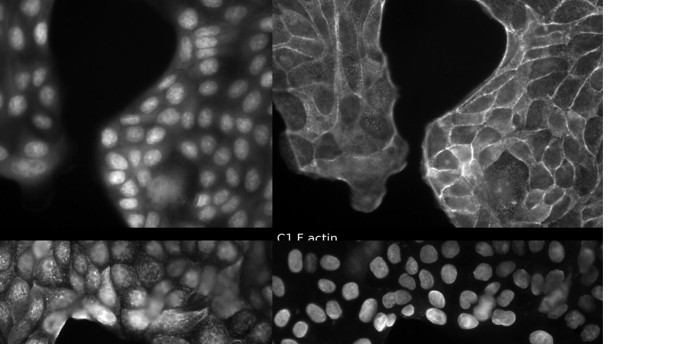

# 5. End-to-end training

The optical model and the network form **one differentiable pipeline**. At each iteration: take a sharp image, simulate what the microscope would record at several depths (and wavelengths), reconstruct, compare with the sharp image, and update *both* the optics and the network from the same loss.

## Datasets

=== "Publication I"

    1,800 grayscale images of 1000 × 1000 px (from Jin et al., PNAS 2020), 600 of each type:

    - fluorescence images of proflavine-stained oral-cancer resections,
    - histopathology images (healthy and cancerous tissue, TCGA),
    - natural images (INRIA Holidays).

    Split 1500 / 150 / 150 (train / validation / test). Random 256² crops, rotations, flips and brightness changes. The mixture exposes the network to features at many scales.

=== "Publication II (MANTIS)"

    **423 four-channel MDCK fluorescence images**, acquired on a Nikon ECLIPSE Ti2 with a 60×/1.4 NA oil objective. Labels: DAPI (nuclei, 433 nm), Alexa Fluor 488 (lamin A/C, 521 nm), Alexa Fluor 568 (vimentin, 601 nm), Atto 643 phalloidin (F-actin, 681 nm).

    Plus **37 hyperspectral natural images** (Imamoglu et al., QoMEX 2018). For each, the four bands whose centre wavelengths are closest to the emission channels are selected.

    Total: 460 images of 512 × 512 px (about 92 % fluorescence, 8 % natural), split 80 / 10 / 10. Augmentation: rotations, flips, brightness. The natural images add spatial and spectral structure that one cell type lacks.

    :material-database: **Download:** [Zenodo, doi:10.5281/zenodo.18609221](https://doi.org/10.5281/zenodo.18609221)

<figure markdown="span">
  { width="620" loading=lazy }
  <figcaption>Examples from the four-channel MDCK dataset (from the MANTIS repository).</figcaption>
</figure>

## Sampling depths (uniform in diopters)

At each iteration, a ground-truth patch is assigned to \(K\) axial positions spread **uniformly in diopters** (in \(1/z\)) across the target range. The defocus phase is proportional to \(1/z - 1/z_0\), so this spacing gives evenly spaced defocus coefficients \(\psi\).

| | Target DoF | \(K\) |
|---|---|---|
| Publication I | ±100 µm, ±1 mm, ±1.5 mm | 5 |
| Publication II | 25 µm, 50 µm | 5 |
| Publication II | 75 µm | 7 |

More depths did not help. For the multispectral meta-optic the PSFs vary smoothly with depth, so a few planes cover the range, and extra planes mainly add gradient noise.

The ground truth is the same for every depth (\(GT_{z,\lambda} = GT_\lambda\)), and the losses are **averaged over all \(K\) depths** (and \(C\) channels). A design that is sharp at focus but loses information elsewhere is penalised.

## Loss functions

=== "Publication I"

    Root-mean-square error averaged over depths (\(N\) pixels, \(M\) depths):

    \[
    \mathcal{L}_{\mathrm{I}} = \frac{1}{M}\sum_{i=1}^{M}\frac{1}{\sqrt{N}}\,\big\lVert x - \hat{x}_{z_i}\big\rVert_2 .
    \]

=== "Publication II"

    A pixel loss alone gives over-smooth results under strong blur. The multispectral loss combines four terms, averaged over \(K\) depths and \(C\) channels:

    \[
    \mathcal{L}_{\mathrm{II}} = \frac{1}{KC}\sum_{z,\lambda}\Big[
    w_{\mathrm{RMSE}}\,\mathrm{RMSE} + w_{\mathrm{SSIM}}\,(1-\mathrm{SSIM}) + w_{\mathrm{grad}}\,\ell_{\mathrm{grad}} + w_{\mathrm{LP}}\,\mathrm{MSE}_{\mathrm{low\text{-}pass}}
    \Big]
    \]

    - **RMSE**: pixel fidelity, the dominant term.
    - **1 − SSIM**: local luminance, contrast and structure.
    - **\(\ell_{\mathrm{grad}}\)**: L1 on horizontal and vertical finite differences, which sharpens cell boundaries and filaments.
    - **Low-pass MSE**: matches blurred versions of output and target, which fixes coarse intensity balance between channels.

    L2 weight decay is applied to the network only: \(\mathcal{J} = \mathcal{L}_{\mathrm{II}} + \beta\lVert\theta\rVert_2^2\).

!!! note "No PSF-similarity term"
    Neither loss asks the PSFs to look alike across depth. Depth robustness **emerges** because one network must serve all depths. Optimising the image, not an intermediate PSF property, lets the optics find solutions a hand-made criterion would miss.

## Initialisation of the meta-optic

*(Publication II)* A cubic-phase start is common, but at \(\psi_{\max} > 100\) it gave extremely blurred sensor images and a weak signal for the network. MANTIS therefore starts from a **flat π phase** and **pre-optimises the optics alone for 30 epochs** with a frequency-domain EDoF objective:

1. From the simulated PSF stack, compute the DC-normalised radial MTF \(M_\lambda(\rho, z)\) at each depth and wavelength.
2. Compare it with a target pass-band \(T(\rho)\) (1 up to a cutoff \(\rho_{\mathrm{cut}}\)).
3. Aggregate over depths with a **soft maximum**, so the worst depth dominates:

    \[
    \mathcal{L}_{\mathrm{EDoF},\lambda} = \frac{1}{\beta}\log\sum_z \exp\!\Big(\beta\,\big\lVert M_\lambda(\rho,z) - T(\rho)\big\rVert_1\Big).
    \]

4. Aggregate over wavelengths, with extra weight on the currently worst channel \(\lambda^\ast\):

    \[
    \mathcal{L}_{\mathrm{EDoF}} = \lambda_{\mathrm{focus}}\,\mathcal{L}_{\mathrm{EDoF},\lambda^\ast} + (1-\lambda_{\mathrm{focus}})\,\frac{1}{\eta}\log\sum_\lambda \exp\big(\eta\,\mathcal{L}_{\mathrm{EDoF},\lambda}\big).
    \]

The result is a physically sensible seed that spreads contrast evenly across depth and wavelength. End-to-end training then refines it.

## Gradient flow

For one image, depth and wavelength, the forward pass is the chain

\[
\gamma \;\xrightarrow{\text{Rot}}\; \Gamma \;\xrightarrow{\text{Interp}}\; \phi_\lambda \;\to\; P_{z,\lambda} \;\to\; h_{z,\lambda} = \lvert E_{z,\lambda}\rvert^2 \;\to\; y_{z,\lambda} = x_\lambda * h_{z,\lambda} + n \;\to\; \hat{x}_{z,\lambda} = f_\theta(y) \;\to\; \mathcal{L}.
\]

Automatic differentiation carries \(\partial\mathcal{L}/\partial\hat{x}\) back through the network, the convolution, the squared magnitude, the Fourier transforms and the complex exponential. The one non-standard link is the **unit-cell library**: the local slope of the interpolation \(\partial\phi_\lambda/\partial w\) turns phase gradients into width gradients. Losses from all four channels therefore update **one shared geometry**. Full expressions are in Supplementary Section 7 of Publication II.

## Optimisation settings

| | Publication I | Publication II |
|---|---|---|
| Optimiser | Adam | Two Adam optimisers (optics / network) |
| Learning rate, optics | 1e-7 | 1e-2 (no weight decay) |
| Learning rate, network | 1e-4 | 1e-4 (weight decay 1e-3) |
| Schedule | Train U-Net with fixed optics, then joint training | 30-epoch MTF pre-optimisation of the optics, then joint training |
| Noise | Gaussian, \(\mathcal{N}(0,\sigma_s^2)\) | Gaussian |
| Hardware | 2 × Tesla P100 (12 GB) | 1 × Tesla V100 SXM2 (32 GB) |
| Training time | ≈ 6 h 41 min (easiest) to ≈ 148 h 33 min (hardest) | ≈ 44 h 36 min per model on average |
| Framework | PyTorch | PyTorch (+ PyTorch Lightning) |
