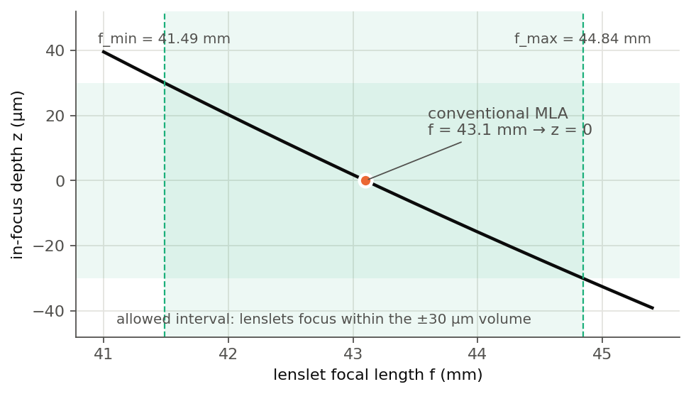
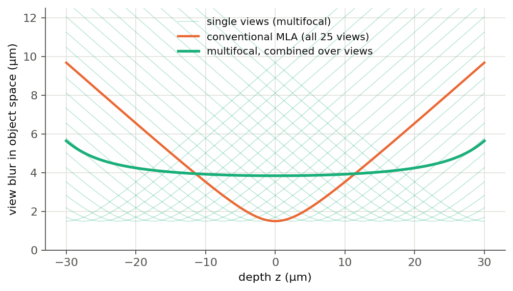
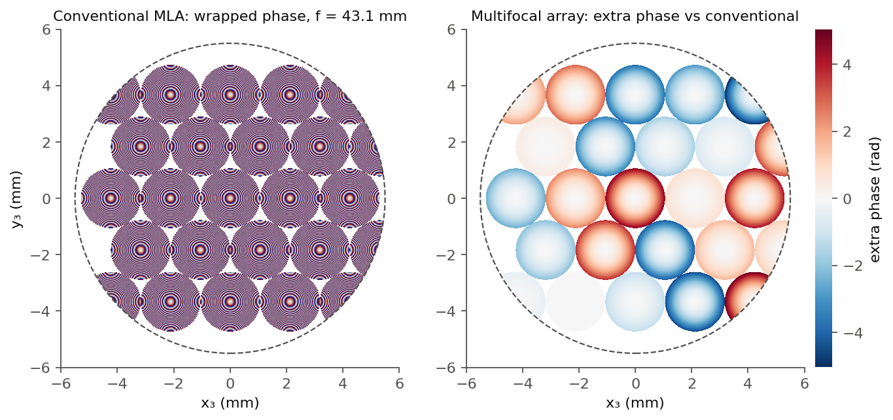

# 2. Learned encoder

The encoder is a **structured phase mask array**: lenslets on the hexagonal lattice of the commercial MLA, each described by a few physical parameters. This keeps the search space small, the optimisation stable, and the result physically interpretable and manufacturable.

## Lenslet parameterisation

Lenslet \([m,n]\), centred at \((u_{m,n}, v_{m,n})\) in the Fourier plane, applies a quadratic phase within its aperture:

\[
\phi_{m,n}(u,v) = -\frac{\pi}{\lambda f_{m,n}}\Big[(u-u_{m,n})^2 + (v-v_{m,n})^2\Big],
\qquad
P(u,v) = A\big(u,v; D_{m,n}\big)\, e^{\,i\phi_{m,n}(u,v)} .
\]

| Design | Learned parameters \(\Theta\) | Fixed |
|---|---|---|
| Conventional MLA (baseline) | none | \(f_{m,n} = f_{\mathrm{MLA}} = 43.1\) mm, \(D_{m,n} = D_{\mathrm{pitch}} = 2.12\) mm |
| **Learned \(f\)** (main design) | 25 focal lengths \(f_{m,n}\) | \(D_{m,n} = 2.12\) mm, positions |
| Learned \(f, D\) (ablation) | 25 focal lengths and 25 diameters | positions |

The gradient of the phase with respect to a focal length is

\[
\frac{\partial\phi_{m,n}}{\partial f_{m,n}} = \frac{\pi}{\lambda f_{m,n}^2}\Big[(u-u_{m,n})^2 + (v-v_{m,n})^2\Big],
\]

so learning \(f\) changes the **curvature** of each lenslet's phase. This shifts the depth at which that lenslet's view is in focus.

## Focal length ↔ in-focus depth

With the sensor fixed at \(f_{\mathrm{MLA}}\) behind the encoder, a lenslet of focal length \(f\) brings the depth

\[
z = n\, m^2 f_{\mathrm{obj}}^2 \left(\frac{1}{f} - \frac{1}{f_{\mathrm{MLA}}}\right)
\]

into focus, where \(n = 1.33\), \(f_{\mathrm{obj}} = 3.0\) mm and \(m \approx 1.67\) is the pupil-to-Fourier-plane magnification (\(n m^2 f_{\mathrm{obj}}^2 \approx 33.3\) mm²). The **allowed interval** for \(f\) is set so that the extreme lenslets focus exactly at the edges of the ±30 µm volume:

\[
f_{\min} = 41.49 \text{ mm} \;(z = +30\ \mu\text{m}),
\qquad
f_{\max} = 44.84 \text{ mm} \;(z = -30\ \mu\text{m}).
\]

Focusing beyond the reconstructed volume returns no usable signal, so the interval is not widened.

<figure markdown="span">
  { width="560" loading=lazy }
  <figcaption>In-focus depth against lenslet focal length from the relation above. The shaded band is the allowed interval: a ±4 % change of focal length sweeps the focus through the whole 60 µm volume.</figcaption>
</figure>

### Why focal-length diversity helps

With one focal length, every view is sharp at the same plane and equally blurred away from it. With different focal lengths, each depth has some views close to focus. The sketch below uses a simple per-lenslet blur model to show the trade this creates: the combined views are less sharp at the focal plane but much sharper at the edges of the volume.

<figure markdown="span">
  { width="600" loading=lazy }
  <figcaption>Toy model (geometric defocus blur combined with the diffraction spot of each lenslet; views combined by sharpness). Focal lengths are spread evenly over the allowed interval for illustration; they are not the learned values. Generated by <code>examples/flfm_figures.py</code>.</figcaption>
</figure>

**Optimisation.** The learned-\(f\) arms start from focal lengths drawn uniformly in \([f_{\min}, f_{\max}]\) with a fixed seed. After every optimiser step the parameters are clamped back into the interval (projected gradient). Clamping in the forward pass would zero the gradient at the bounds.

## Aperture ablation: learned \(f, D\)

In the ablation each lenslet also has its own diameter \(D_{m,n} \in [0.25, 1.75] \times D_{\mathrm{pitch}}\), initialised at \(D_{\mathrm{pitch}}\) so that training starts from the same encoder as the learned-\(f\) design.

- **A hard aperture with a usable gradient.** A binary disc has no useful derivative with respect to its radius. The forward pass uses the hard disc, and the backward pass uses a sigmoid-smoothed surrogate (a straight-through estimator).
- **Overlap.** Diameters may exceed the pitch, so neighbouring supports can overlap. Lenslets are written **sequentially** onto one Fourier-plane grid, and a later lenslet overwrites an earlier one where they overlap. Every grid point therefore carries the phase of exactly one lenslet, and the encoder is a single, well-defined complex transmittance. \(D_{m,n}\) is the *candidate* support. The realised support is what remains after overwriting.

<figure markdown="span">
  { loading=lazy }
  <figcaption>Left: wrapped phase of the conventional array over the 11.0 mm pupil. Right: extra phase of a multifocal array relative to it, for illustrative focal lengths within the allowed interval (not the learned values). Blue: shorter focal length, stronger curvature, focus moved towards +z. Red: longer focal length, focus towards −z. Lenslet positions (centre lenslet on the axis, odd rows offset by half a pitch) and pitch are unchanged. Generated by <code>examples/flfm_figures.py</code>.</figcaption>
</figure>

## Fourier-plane sampling

The numerical grid must resolve the highest spatial frequency introduced by the quadratic phase of each lenslet. For a lenslet of focal length \(f_{\mathrm{MLA}}\) and radius \(R_{\mathrm{MLA}}\), the largest phase gradient occurs near the aperture boundary, with maximum spatial frequency

\[
f_{\max} = \frac{k\,R_{\mathrm{MLA}}}{f_{\mathrm{MLA}}},\qquad k = \frac{2\pi}{\lambda}.
\]

To avoid aliasing of the phase modulation, the sampling interval follows the Nyquist condition

\[
\frac{\pi}{\Delta s} \ge 2 f_{\max}
\quad\Longrightarrow\quad
\Delta s \le \frac{\lambda f_{\mathrm{MLA}}}{4 R_{\mathrm{MLA}}}.
\]

For \(f_{\mathrm{MLA}} = 43.1\) mm, \(\lambda = 633\) nm and \(R_{\mathrm{MLA}} = 2.12\) mm, this gives a maximum sampling interval of about **3.22 µm** in the corresponding pupil plane. With the relay demagnification of 0.6, this is about **5.36 µm** at the Fourier plane. The implementation uses **5.175 µm**, which satisfies the condition after relay scaling and gives an integer sampling grid for the 5 × 5 encoder (2125 × 2125 samples) while keeping the simulation tractable. It is also a whole number (23) of 225 nm TiO₂ unit cells, so the learned phase can later be written as a nanopillar metasurface (thesis Section 4.6).

For the learned designs, the condition is evaluated with the most demanding parameters the optimisation bounds allow, the minimum focal length and the maximum aperture diameter, so that the grid resolves the largest phase gradient that can occur during training.

!!! success "Next"
    How the encoded image is turned back into a volume: [Reconstruction and training](reconstruction.md).
