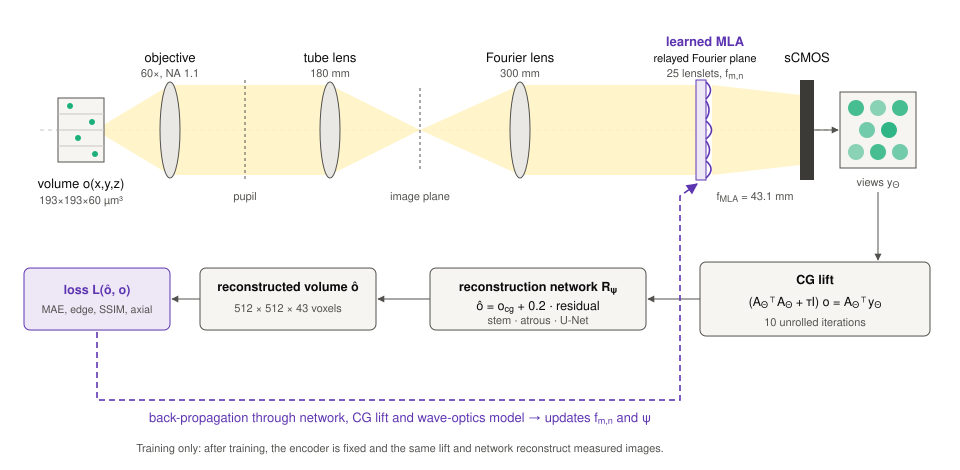

# Fourier light field microscopy with learned phase mask arrays

**Goal:** recover a full **3D fluorescence volume** from **one camera frame**, with an encoder that is still a manufacturable microlens array.

**Approach:** keep the periodic hexagonal 5 × 5 microlens array (MLA) of a conventional Fourier light field microscope (FLFM), and learn only the **focal length of each of its 25 lenslets**. Training is joint with a physics-guided reconstruction pipeline through a differentiable wave-optics model. Learning the lenslet **aperture diameters** as well is studied as an ablation.

!!! info "Status"
    Results in simulation. The manuscript (Publication III) is in submission, and the thesis covers the same work in Chapter 4. Code is in the [`code/flfm`](reproduce.md) folder of this site's repository.

<figure markdown="span">
  { loading=lazy }
  <figcaption>Optical path and reconstruction pipeline. The learned lenslet array sits at the relayed Fourier plane and forms 25 views on the sensor. A conjugate-gradient lift against the encoder-dependent operator gives a first volume, which a network refines. During training the loss is back-propagated through the network, the lift and the wave-optics model to the lenslet focal lengths.</figcaption>
</figure>

## Why Fourier light field microscopy?

A light field microscope records **spatial and angular** information in one exposure, so a single frame contains enough parallax to reconstruct depth. The price is a **sampling budget**: a 4D light field is packed onto a 2D sensor, so angular views are paid for with lateral pixels.

Placing the MLA at a plane **conjugate to the objective pupil** (the Fourier plane), instead of at the image plane, has two advantages:

- each lenslet samples a sub-aperture of the pupil and forms one **perspective view** on the sensor, with uniform sampling across depth and fewer artefacts near the native focal plane;
- the image formation is **laterally shift-invariant**, described by one depth-dependent PSF per plane, so reconstruction reduces to FFT-based convolutions.

The MLA alone decides how spatial and angular information share the sensor. A conventional MLA uses one focal length and one aperture for every lenslet. This work asks how much a **task-optimised choice of these few physical parameters** can improve the volumetric reconstruction, with the geometry left unchanged.

## What is new

1. **A constrained, interpretable encoder.** Lenslet positions and pitch stay those of a commercial MLA. Only the 25 focal lengths are learned. This isolates the role of **focal-length diversity** from spatial rearrangement, which earlier Fourier-plane encoders (Fourier DiffuserScope, Markley et al.) changed at the same time.
2. **A physics-guided lift.** The sensor image is mapped to a first volume estimate by an **unrolled conjugate-gradient** solve of the regularised normal equations. A residual network then refines it. Gradients reach the optics through both.
3. **A realistic noise model.** Mixed Poisson–Gaussian sCMOS noise, evaluated over **two orders of magnitude** of photon budget.

## Headline results (simulation, 12 held-out volumes, N = 100 photons)

3.83 → 2.14

depth spread of effective lateral resolution (fixed vs learned f)

6.9 → 4.6–5.3 µm

effective lateral resolution at the volume edges (z = ±30 µm)

2.1–2.3

depth spread of the learned encoders from N = 10 to 1000 photons

2.2 s vs 15.7 s

per volume, CG + network vs RL-TV (V100)

The learned encoder spreads performance more evenly through depth. It is better at the edges of the volume and slightly coarser at the focal plane, where the conventional MLA is matched. Volume-averaged PSNR improves by 0.57 dB.

## System at a glance

| Quantity | Value |
|---|---|
| Objective | Evident LUMFLN60XW, 60×, NA 1.1, water immersion, f = 3.0 mm (native DoF ≈ 0.8 µm) |
| Tube lens / Fourier lens | 180 mm / 300 mm (pupil magnified 1.67× to 11.0 mm) |
| MLA (baseline) | AMUS APH-Q-P2120-R19.7: hexagonal, fused silica, pitch 2.12 mm, R = 19.7 mm, f = 43.1 mm at 633 nm |
| Illuminated lenslets | 5 × 5 hexagonal sub-array (the pupil spans 5.19 pitches) |
| Wavelength | 633 nm |
| Camera pixel | 6.5 µm (sCMOS) |
| Reconstructed volume | 512 × 512 × 43 voxels = 193 × 193 × 60 µm³ (0.377 µm laterally, 1.43 µm axially) |

## Reading order

1. [Forward model](forward-model.md): high-NA Debye pupil, relay, encoder, propagation to the sensor.
2. [Learned encoder](encoder.md): lenslet parameterisation, focal-length bounds, aperture ablation, sampling.
3. [Reconstruction and training](reconstruction.md): conjugate-gradient lift, network, loss, noise model.
4. [Results](results.md): learned optics, volumetric quality across depth, photon budget, unseen specimens.
5. [Reproduce](reproduce.md): code, data format and commands.
6. [Limitations and outlook](limitations.md)
