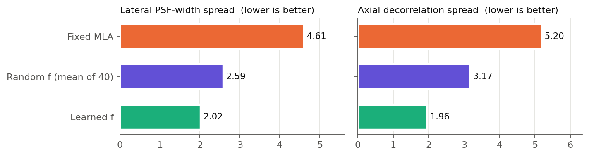
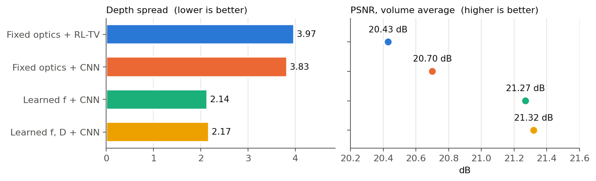
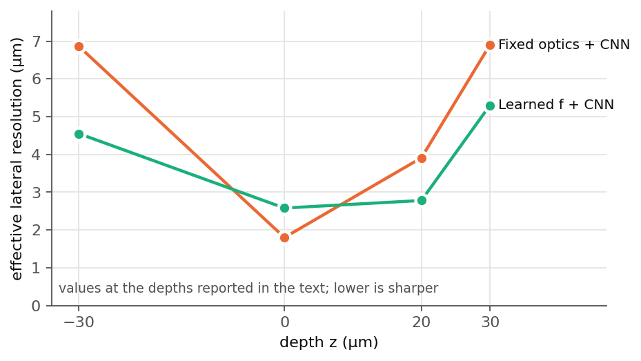

# 4. Results

Four arms are compared, all with the same data, noise model and detector sampling:

| Arm | Encoder | Reconstruction |
|---|---|---|
| Fixed optics + RL-TV | conventional MLA | Richardson–Lucy + TV (no training) |
| Fixed optics + CNN | conventional MLA | CG lift + network |
| **Learned \(f\) + CNN** | learned focal lengths | CG lift + network |
| Learned \(f, D\) + CNN (ablation) | learned focal lengths and diameters | CG lift + network |

**Metrics.** PSNR, SSIM and the Pearson correlation \(\rho\) measure global agreement. The **effective lateral and axial resolution** is estimated by blur matching: the ground truth is blurred with Gaussians, linearly intensity-matched to the reconstruction, and the best-fitting width is reported as a FWHM. The **depth spread** is the ratio of the worst to the best per-depth mean lateral resolution. A value of 1 means uniform quality through the volume.

## Learned optics

- **Learned \(f\):** focal lengths from 41.5 to 44.8 mm (mean 43.3 mm, s.d. 1.2 mm) against the 43.1 mm baseline. The encoder becomes **multifocal**, with in-focus depths spanning −30 to +30 µm. Seven of the 25 lenslets settle at the limits of the allowed interval, that is, exactly at the edges of the volume, where the fixed encoder is weakest.
- **Learned \(f, D\):** diameters from 1.92 to 3.71 mm (mean 2.62 mm, s.d. 0.47 mm), with the largest at the upper bound of 1.75 × pitch. There is no systematic spatial pattern: large and small apertures are interleaved. This is consistent with the small extra gain below and suggests the aperture plays a secondary role to the focal length.

### Is a learned map better than a random one?

Forty random focal maps were drawn from the same interval and compared on the PSF stacks alone, with no network involved:

| Encoder | Lateral PSF-width spread | Axial decorrelation spread |
|---|---|---|
| Fixed MLA | 4.61 | 5.20 |
| Random \(f\) (mean of 40) | 2.59 | 3.17 |
| **Learned \(f\)** | **2.02** | **1.96** |

Random diversity already recovers much of the gap. The learned map is better **axially than every one of the 40 draws** (p = 0.024 by rank) and better laterally than 36 of them. The two designs differ in *where* they place performance. Random maps improve all depths roughly evenly, while the learned map moves performance from the focal plane to the edges: the lateral width beyond |z| = 20 µm relative to within ±10 µm is 3.19 (fixed), 1.72 (random) and 1.26 (learned).

<figure markdown="span">
  { loading=lazy }
  <figcaption>Spread (worst / best over depth) of the effective lateral PSF width and of the axial decorrelation depth, computed from the PSF stacks. Values from Publication III, Supplementary Section S9.</figcaption>
</figure>

## Volumetric reconstruction

| Model | Depth spread ↓ | PSNR (dB) | SSIM | \(\rho\) | Time per volume (s) |
|---|---|---|---|---|---|
| Fixed optics + RL-TV | 3.97 | 20.43 | 0.39 | 0.79 | 15.73 |
| Fixed optics + CNN | 3.83 | 20.70 | 0.44 | 0.79 | 2.19 |
| **Learned \(f\) + CNN** | **2.14** | 21.27 | **0.45** | **0.80** | **2.16** |
| Learned \(f, D\) + CNN | 2.17 | **21.32** | **0.45** | **0.80** | 2.17 |

*Averaged over all 43 depths and 12 held-out test volumes, N = 100 photons, 1.0 e⁻ read noise. Time from sensor image to volume on one Tesla V100-SXM2-32GB.*

<figure markdown="span">
  { loading=lazy }
  <figcaption>Depth spread and volume-averaged PSNR of the four arms (values from the table above).</figcaption>
</figure>

**Where the gain is.** The learned encoder trades sharpness at the plane the conventional MLA is matched to for sharpness everywhere else:

| Effective lateral resolution | z = −30 µm | z = 0 | z = +20 µm | z = +30 µm |
|---|---|---|---|---|
| Fixed optics + CNN | 6.86 µm | 1.80 µm | 3.91 µm | 6.90 µm |
| Learned \(f\) + CNN | 4.55 µm | 2.58 µm | 2.78 µm | 5.30 µm |

<figure markdown="span">
  { width="560" loading=lazy }
  <figcaption>Effective lateral resolution at the depths reported in the text: the learned encoder is coarser at the focal plane and sharper towards both edges of the volume.</figcaption>
</figure>

- **Axially**, the fixed encoder ranges from 13.4 µm (−30 µm) to 10.4 µm (focus), while the learned \(f\) encoder stays between 10.1 and 11.2 µm. RL-TV gives the smallest axial estimates (8.2–10.1 µm).
- **Globally**, learning \(f\) adds 0.57 dB PSNR and 0.01 SSIM, with the largest gains at the volume edges (17.3 → 18.5 dB at −30 µm).
- **Fourier ring correlation**, which assumes no blur model, gives the same picture: mean resolution 5.78 → 5.02 µm (learned \(f\)) and 4.93 µm (learned \(f, D\)), with depth spread 2.36 → 1.74 and 1.51.
- **Near focus**, RL-TV has the smallest blur-matched width but looks grainier and has lower PSNR and SSIM there. A smaller fitted width is not the same as a better reconstruction.

### The gain comes from the optics

Reconstructing the **learned** encoders' measurements with **RL-TV**, which was never part of the training, gives a similar improvement:

| RL-TV on | Depth spread | PSNR (dB) |
|---|---|---|
| Fixed MLA | 3.97 | 20.43 |
| Learned \(f\) | 2.01 | 21.05 |
| Learned \(f, D\) | 1.84 | 20.88 |

The learned encoder improves **the measurement itself**, not only the network it was trained with.

## Robustness to the photon budget

All networks were trained at \(N = 100\) and tested from \(N = 10\) to \(1000\) with no retraining.

- **Depth spread** separates the arms at every budget and stays flat: 2.1–2.3 for both learned encoders, against 3.8–4.0 (fixed + CNN) and 3.9–4.0 (RL-TV). The uniformity is a property of the optics, not of the training noise level.
- **Lateral resolution** keeps its ordering: RL-TV 2.82–2.85 µm, learned 2.9–3.4 µm, fixed 3.9–4.1 µm.
- **PSNR**: at \(N = 10\) the CNN arms lead RL-TV by just over 3 dB (≈ 18.7 vs 15.5 dB), thanks to the learned prior. RL-TV overtakes at about \(N = 300\) and ends about 0.4 dB ahead at \(N = 1000\). In SSIM the CNN arms stay above RL-TV throughout.

## Unseen specimen types

Seven confocal volumes that differ from the training tissue in morphology, labelling density and frequency content: *Arabidopsis* hypocotyl (GFP–MBD) and cotyledon pavement cells (propidium iodide), fixed and living planaria (*Schmidtea mediterranea*), and an MDCK organoid (DAPI). Each was **resampled** to the training voxel grid (0.377 × 1.43 µm) before forward projection, so that it carries its true physical depth. No fine-tuning was done.

| Mean over 7 volumes | Fixed + CNN | Learned \(f\) | Learned \(f, D\) | RL-TV |
|---|---|---|---|---|
| PSNR (dB) | 20.62 | 20.81 | 20.91 | **22.35** |
| 3D SSIM | 0.516 | 0.514 | 0.520 | **0.610** |

The learned models recover the main 3D morphology and keep more continuous axial structure than the fixed baseline. Under this distribution shift, however, **RL-TV is more accurate on average** (about 1.5 dB), and the gains from optical learning shrink (+0.19 and +0.29 dB, not consistent across specimens). On the planarian sample the learned encoders are best (23.0 and 23.3 dB); on the MDCK organoid RL-TV leads by 4.0 dB. The CNN arms keep their speed advantage (about 1/7 of the RL-TV time).
