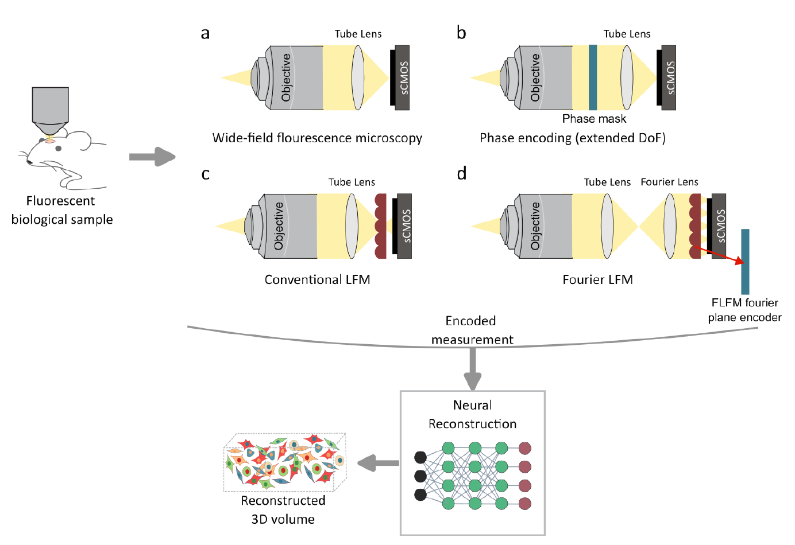

---
hide:
  - navigation
---

# Wavefront Coding for Computational Microscopy

**From optical encoding to neural reconstruction.** This site documents my PhD work at Tampere University (Finland) and Université de Rennes / INRIA (France). It explains the physics, the methods and the results, and shows how to reproduce them.

!!! abstract "The idea in one paragraph"
    A high-NA fluorescence microscope resolves fine detail, but only in a very thin slice of the sample. Scanning through depth is slow and exposes the sample to more light. My approach does not ask the optics to form a sharp image on the camera. Instead, a thin **learned phase element** in the microscope's Fourier plane *encodes* the image, and a **neural network** *decodes* it. The two are trained together (end-to-end) through a physics-based, differentiable model of the microscope. The result is a camera image that can be decoded over a much larger depth range, captured in a single shot.

50 µm

single-shot EDoF at NA 1.1, shown experimentally

82×

larger than the native DoF of the same wide-field microscope

4 channels

433, 521, 601, 681 nm through one shared meta-optic

21 fps

reconstruction of 1280 × 1280 images (V100 GPU)

<figure markdown="span">
  { width="720" loading=lazy }
  <figcaption>Encoding strategies in fluorescence imaging: (a) wide-field, (b) Fourier-plane phase encoding for extended depth of field (this work, Part 1), (c) conventional and (d) Fourier light field microscopy for snapshot volumes (Part 2). Thesis Fig. 2.1.</figcaption>
</figure>

## Two problems, one principle

Both parts put a flat optical element in the **Fourier plane** (a plane conjugate to the objective pupil). There it reshapes the point spread function (PSF) of the whole microscope. The element is then optimised together with the reconstruction network.

-   :material-image-filter-center-focus-weak:{ .lg .middle } **Part 1: Extended depth of field (EDoF)**

    ---

    Recover **one sharp 2D image** over a large depth range from a single exposure, at high NA and across several colour channels.

    Publications I and II. Status: **complete**, code and data public.

    [:octicons-arrow-right-24: Start here](edof/index.md)

-   :material-cube-scan:{ .lg .middle } **Part 2: Fourier light field microscopy (FLFM)**

    ---

    Recover a **full 3D volume** from a single exposure by learning the focal length of each lenslet in a standard microlens array.

    Publication III, in submission. Status: **simulation complete**, code public.

    [:octicons-arrow-right-24: Read more](flfm/index.md)

-   :material-sine-wave:{ .lg .middle } **Physics background**

    ---

    Why the depth of field is shallow, how the 4f system, pupil, PSF and MTF are connected, what wavefront coding does, and how DOEs and metasurfaces shape light.

    [:octicons-arrow-right-24: Read the background](background/index.md)

-   :material-code-braces:{ .lg .middle } **Reproduce**

    ---

    Pretrained MANTIS models and dataset, the full FLFM training framework, and two small scripts that recreate the key design numbers and figures.

    [:octicons-arrow-right-24: EDoF](edof/reproduce.md) · [:octicons-arrow-right-24: FLFM](flfm/reproduce.md)

## How to read this site

| If you want to… | Go to |
|---|---|
| understand the optics from scratch | [Physics background](background/index.md) → [Toy simulation](background/toy-simulation.md) |
| understand the EDoF method | [EDoF overview](edof/index.md), then pages 1–5 in order |
| understand the FLFM method | [FLFM overview](flfm/index.md), then pages 1–3 in order |
| see the results | EDoF: [simulation](edof/simulation-results.md), [experiments](edof/experiments.md) · FLFM: [results](flfm/results.md) |
| run the code | [EDoF](edof/reproduce.md) · [FLFM](flfm/reproduce.md) |
| cite the work | [Publications and citation](resources/publications.md) |

## People and funding

**Author:** Ipek Anil Atalay Appak ([ORCID 0000-0001-5327-7423](https://orcid.org/0000-0001-5327-7423))

**Supervisors:** Prof. Humeyra Caglayan (Tampere University; now TU Eindhoven), Prof. Christine Guillemot (INRIA Rennes), Dr. Erdem Sahin (Tampere University).

**Collaborators:** Haobijam Johnson Singh (microscope setup and experiments), Sanna Korpela and Dr. Teemu O. Ihalainen (samples and staining).

This work received funding from the European Union's Horizon 2020 research and innovation programme under the Marie Skłodowska-Curie grant agreement No. 956770 (PLENOPTIMA). It was also supported by the Research Council of Finland (project 336357, PROFI 6 – TAU Imaging Research Platform) and by the Jane and Aatos Erkko Foundation (Future Makers programme).
